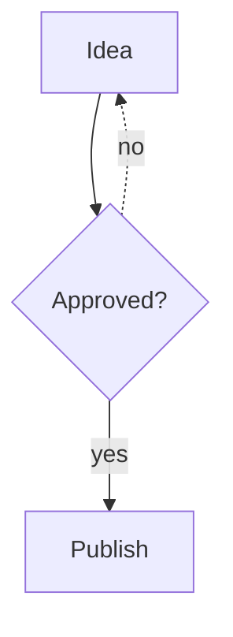

# Building a Papyrus static site

A Markus static site is a `web/` folder and nothing else. Papyrus core renders it: pages, listings, tags, sitemap,
robots.txt, a 404 page, RSS and Atom feeds, and every head tag search engines and social cards read. A site
supplies **settings** (`projection.json`), a **theme** (CSS and tokens), **brand assets**, **nav and redirect data**
and, only when settings are not enough, a few **named hooks**. It does not write a projector, a sitemap writer, a
feed generator or an edge function.

Editorial content and anything that should change over time (articles, aliases, descriptions, dates, tags) is
backend data in the CMS, not a file in the repository.

## The smallest site

```json
{ "site": { "name": "Example" } }
```

Put that in `web/projection.json` and the site works: a home page, one page per published item at `/<slug>.html`,
one flat paginated listing at `/archive/`, tag pages when items have tags, `sitemap.xml`, `robots.txt`, `404.html`,
`feed.xml` and `atom.xml`. There are **no sections**: no section bases in URLs, no empty section pages, no section
UI. Sections are an option you add (below), never a requirement.

The top-level `site` object is the opt-in. A project whose `projection.json` has none keeps today's bare
`MarkusSiteProjector`, byte for byte.

## `projection.json`

Every block is optional except `site.name`. Unknown keys are errors.

| Key | Contents |
|---|---|
| `site` | `name`, `shortName`, `publisher`, `tagline`, `description`, `language` (default `en`), `productionUrl`, `author`, `componentsCss` (default `true`: ship the baseline component CSS), `summaryFields` (ordered front matter fields for the summary; default `description`, `summary`, `excerpt`, `blurb`, `dek`, `standfirst`), `dateFormat` (a `strftime` pattern such as `%B %d, %Y` for the dates the core components and the article header print; default: ISO dates), `ledeField` (a front matter field whose text is printed as the article's lede under its title, in place of the summary-derived one; default: none) |
| `urls` | `style`: `html` (`/x.html`, default), `directory` (`/x/`) or `clean` (stored as `x.html`, addressed as `/x`). `sections`: `{ "<section>": { base, label, description, pages, listing, listingPage, feed, sitemap, linkField, pageSize, listEmpty, sort, groupBy, archive, aliases } }`. `types`: `{ "<Item type>": { base, label, ... } }`, the same settings keyed on the Item's type instead of its section (see "Sections and types"). Leave both out for a site without sections. `basePath` (for example `"/posts"`): every page and file Papyrus generates, and every URL it builds, lives under that path, so another site's CDN can serve the projection with one route (see [Serving a projection under a host site's path](site-hosting.md#serving-a-projection-under-a-host-sites-path)). Paths you write yourself (nav and footer links, `seo` and `icons` paths, redirects, aliases, links in articles) are request paths and are used as written, so they include the base path. `404.html` and `robots.txt` stay at the bucket root. Image renditions, listing copies and `media.originals` objects live under the base path too (`/posts/assets/responsive/...`), and the image URLs in a page are root-relative under it (a site at the root keeps page-relative `../assets/...` URLs) |
| `nav` | `links: [{label, href, cta, external, children}]` (`external` adds `rel="noopener"`; `children: [{label, href}]` makes a dropdown group, see "Header and footer options"), `disclosure` (a menu button for narrow screens), `homeLabel`, `brandHtml` (trusted markup inside the wordmark link) |
| `footer` | `columns: [{title, links}]`, `text`, `family` (the Anthus family footer, see "Header and footer options") |
| `seo` | `defaultImage`, `defaultImageAlt` (its alt text, used when a page's share image is the default), `homeSocialTitle` (the generated home page's og/twitter title when it differs from the site name), `imageSize: [w, h]`, `twitterSite`, `twitterCreator`, `jsonLdTypes: {section-or-type: "NewsArticle"}`, `defaultJsonLd`, `publisherName`, `breadcrumbs`, `isBasedOnField` (a front matter field holding the absolute URL of the original a page is based on; it becomes `isBasedOn` in the article JSON-LD), `articleTypes` (entry types that are not listed but still report `og:type` article and Article JSON-LD) |
| `sitemap` | `style`: `single` (`/sitemap.xml`) or `index` (`/sitemap-index.xml` + `/sitemap-0.xml`); `lastmod`; `tags`; `extra`: paths (starting with `/`) to list that core does not generate, such as `static.copy` routes |
| `robots` | `extra`: extra lines |
| `feeds` | `formats` (`rss`, `atom`), `count` (30), `rssPath`, `atomPath`, `title` |
| `listings` | `pageSize` (10), `featuredCount`, `path` (the flat listing base, `archive`), `homeCount`, `tags`, `tagBase`, `types` (entry types that are listed, `["article"]`), `tagSelect`, `tagPageSize`, `draft`, `pageSuffix`, `tagTitle` (see "Collections and tag pages"), `bucket` (`week`, `day` or `none`: Stories rank by the editors' stars inside a rolling window counted back from the projection day, the last seven days by default, newest window first; [how](content-item-lifecycle.md#published-stories-rank-by-recency-bucket-then-stars-ppy-5966d7)) |
| `collections` | listings selected by tag or section: `[{id, base, label, description, select, pageSize, featuredCount, sort, ties, drafts, sitemap, sitemapPages, listEmpty}]` (see "Collections and tag pages") |
| `notFound` | the 404 page's head: `{title ("Page not found"), description, noindex (true)}` |
| `fonts` | `stylesheet` (a font CSS URL; adds the `preconnect` links), `preconnect` |
| `icons` | `icon`, `iconType`, `appleTouch`, `manifest`, `themeColor`, `themeColorDark` |
| `environment` | `guard` (default `true`) |
| `redirects` | `exact: {"/old/": "/new/"}`, `patterns: [{pattern, to, status, except}]` |
| `pages` | custom generated pages: `[{id, path, title, description, dependsOn, sitemap, noindex, form, source, image, imageAlt, socialTitle}]`; the body comes from the `main` or `page_body` hook, or from a page file named by `source` (see "Authored page files"); `path: ""` is the home page  `imageAlt` is the share image's alt text and `socialTitle` the og/twitter title when it differs from `title` |
| `static` | `copy`: directories of `web/` published verbatim at the site root (an exported app, retained routes). They are never owned by the projector, so a reconcile does not delete them; css and assets stay reserved |
| `showcase` | a logo wall fed from published items: `{section, path, title, description, kinds}` (see "Showcase") |
| `forms` | public forms as data (see "Forms"): `{ "<id>": {title, fields, endpoint, submitLabel, honeypot, closedNotice, successText, failureText} }` |
| `agents` | agent-readable output, all on by default: `markdown` (a `.md` twin per page), `llmsTxt`, `llmsFull`, `llmsFullMaxItems` (200), `llmsFullMaxBytes` (1000000), `llmsMaxLinks` (200) |
| `mermaid` | `{enabled}`: ` ```mermaid ` blocks render as diagrams (default on; see Mermaid diagrams) |
| `pageActions` | copy / view / open-in / post / share actions on article pages: `{enabled, placement (header\|aside), actions (copy, view, x, reddit, share), display (text\|icons), ai (chatgpt, claude, perplexity), prompt, types, everywhere}` |
| `wiki` | public wiki pages (see [public-wiki.md](public-wiki.md)): `{types (default ["wiki_page"]), suggestForm (the id of a forms entry), dataLink (default true)}` |
| `components` | `itemByline`, `breadcrumbs`, `itemPagesDependOn` |
| `values` | `{ "name": "text or number" }`: the `{{name}}` tokens of page blocks (see "Page blocks") |
| `islands` | `{script, stylesheet, prerender}`: the site bundle that mounts islands, an optional stylesheet linked on every page, and an optional file of server-rendered island HTML (see "Islands") |
| `hooks` | path of the hooks module, relative to `web/` |
| `theme`, `citations`, `chrome`, `images`, `publicData`, `media` | unchanged from the bare projector: Markus theme, citations, shell options (GA4, consent mode, `title_template`, extra scripts), responsive images, search and latest JSON, originals. `citations` and `images` are on when absent: `"citations": false` and `"images": false` turn them off, and `images` as an object configures the pipeline (see `docs/standard-site.md`, "Images and citations") |

### Sections

```json
"urls": { "style": "directory", "sections": {
  "essays": { "base": "essays", "label": "Essays" },
  "links":  { "base": "links", "label": "Links", "pages": false, "feed": false }
} }
```

An item's section comes from its CMS path (`essays/slow-water`). A section lists its entries at `/<base>/`
(paginated at `/<base>/page/N/`) and only when it has entries. `pages: false` makes a link-only section: items have
no page, appear in listings as cards that link to `linkField` (front matter `url` by default), and are never in
the sitemap or the feeds. `feed: false`, `sitemap: false`, `listing: false` take a section out of that one view. `groupBy` (`week`, Monday start, `month`, or `field:<front matter field>`, which groups by that field's value in the listing's own order, with entries lacking it last under "Other") gives the listing view dated groups (`listing.groups`) which the default listing renders under headings, `archive` (`{by: month|year, base, description}`) adds one page per month or year that has entries at `/<section>/<archive base>/<YYYY-MM>/` (in the sitemap, each with its own inputs), An item named `index` in a declared section is that section's **introduction**: it has no page of its own; its body (and title and description) head the section's listing at `/<base>/`, and a line `{{ section listing }}` in it places the generated cards (otherwise they follow the introduction). `sort: "order"` lists a section by front matter `order` (ascending, then title) instead of newest first. `pageSize` overrides the site's page size for the section, `description` is its listing's meta description, and `listEmpty: true` keeps its listing page when it has no entries (by default an empty section has no page).
Items in a section that is not declared are ignored; items with no section are root pages (`/about.html`).

### Sections and types

A Story has a **type** (`article`, `post`) and a **section**: the topic it is about, which holds the id of a newsroom section
(`agent-security`) or nothing. They are two attributes, and a site chooses which one decides where its pages live. A
`urls.types` entry takes exactly the settings of a `urls.sections` entry and is keyed on `Item.type`:

```json
"urls": { "style": "directory",
  "types": {
    "article": { "base": "articles", "label": "Articles", "listingPage": false },
    "post":    { "base": "posts", "label": "Posts" }
  },
  "sections": { "platform": { "base": "platform", "listingPage": false } }
}
```

With that, an article whose section is `agent-security`, `unsectioned` or nothing at all is published at `/articles/<slug>/`, listed
on the articles listing (when it has a listing page), in the sitemap and in the feeds. The rules, in order:

1. A section the site declares in `urls.sections` (by its name, or by one of its `aliases`) decides the group. A declared section
   therefore wins over the type: that is how Distinctive's `/rulings/` and Shipped's `/open-weights/` stay topic URLs.
2. Otherwise the group declared for the Item's type in `urls.types` decides it, whatever the Item's section string is.
3. Otherwise an Item with a section the site does not declare is ignored (as before), and an Item with no section is a root page.

A site that declares no `urls.types` behaves exactly as it did; there is no other change to read. A type group's name is
`type:<type>` wherever a group is named (`homePage.homeSections`, a hook's `listing.section`, `entry.section.name`), so it can
never be mistaken for a section; `entry.section.item_type` is the type (`None` for a section). The type groups come first in
every list of groups, then the sections in their order. A type group may not share a listing base with another group.

The section as a topic is still there: `select.sections` (collections, `tagSelect`, `::include` `sections=`), `DEPENDS_ON` and
`seo.jsonLdTypes` read the Item's topic (`entry.topic`: the declared section's name, or the section stored on an Item whose group is
its type), and `select.types` / `notTypes` select by type. A topic listing is a collection with `"select": {"sections": ["agent-security"]}`;
there is no other topic page. A type that is not `article` or `page` is projected when `urls.types` names it, as when `listings.types` does.

**Which types the newsroom offers.** `storyTypes` (`{"default": "article", "types": ["article", "post"]}`, both optional) names the Story types an editor can choose in
the newsroom and the type a new Story gets. Without it the offered types are `article` plus every type in `urls.types`. It does not decide where pages live: a type
the site offers but gives no `urls.types` entry (and no `listings.types` entry) is published nowhere, and the editor says "No public URL" under the Type field. See
[content item lifecycle](content-item-lifecycle.md#story-types-and-sections). Changing a published Story's type moves its page to the new type's base and leaves a
redirect from the old address.

`aliases` on a section lists other stored `section` values that mean the same section, for data written before the ids were used
(`"aws": { "base": "aws", "aliases": ["AWS"] }`). It lets a site key its sections on ids while the stored values are migrated.

**Moving a site from section keys to type keys** takes four steps, in this order, and moves no address:

1. Change `web/projection.json` (`urls.sections.articles` becomes `urls.types.article`; collections, `tagSelect` and `::include`
   lines that said `sections: ["articles"]` say `types: ["article"]`) and any site hook that tested `summary.section == "articles"`.
   This works with the data as it is, because an Item whose section is not declared still falls to its type.
2. Prove it: `python -m papyrus_content.projection.url_compare compare --snapshot rows.json --old-static old/web --new-static new/web --plan plan.json`
   projects the site's published rows twice into temporary directories and diffs every generated path, the sitemap, the feeds and the
   redirects (exit status 1 if any differ). `rows.json` is a read-only scan of the `PublishedItem` table; the tool never writes to a
   backend or a bucket. With `--plan` the new side also has the migrated sections.
3. Deploy the site change.
4. Clear the stored values: `python -m papyrus_content.section_migration plan --site NAME --scan-dir scans --static web` prints what would
   change (a dry run: it never writes) and is blocked while the configuration still needs an old value; `apply --plan FILE
   --confirm-site NAME --yes` writes it. See [content item lifecycle](content-item-lifecycle.md#story-types-and-sections).

### Entries

Every view (listings, tags, feeds, sitemap, hooks) reads one extended public entry model built from item summaries,
never from bodies: `title`, `summary_text` (front matter `description`, `summary`, `dek`, `standfirst`, `excerpt`
or `blurb`), `date` (front matter `date`, ISO or written out as in "Sunday, September 6, 2026"; else the published day), `updated` (front matter `updated`, `modified`, `lastmod`, else the published time), `image`
(`image`, `cover`, `ogImage`, `thumbnail`), `authors` (`authors` or `author`), `type`, `canonical`, `tags`,
`section`, `feed_eligible` (not `feed: false`, in a feeding section, has a page), `noindex` (`noindex: true`,
`robots: noindex` or `draft: true`), `listed`, and the raw `data` for hooks.

Hooks read an entry's authors two ways. `entry.authors` is a tuple of plain name strings (`("Ann Lee", "Bo Reed")`), however
the front matter wrote them, so `", ".join(entry.authors)` works in any hook. `entry.author_details` is the same authors as a
tuple of `Author` objects (`papyrus_content.authors.Author`: `name`, and `url`, empty when the front matter gave none);
read it to link a name. `str(author)` is the name.

An entry's `image_dark` is the Night version of its `image` (front matter `imageDark`, `coverDark` or `thumbnailDark`; ignored when
the entry has no `image`). The standard listing cards, which every site gets unless it sets a `card` hook, then carry both
pictures and `markus-components.css` shows one by theme: the system setting, or a theme picked by hand (`dark` or `dark-theme`
on the root element shows Night, `light`, `light-theme` or `data-theme="light"` shows Day). It needs no JavaScript, and the picture
that is hidden is not fetched. Social images (`og:image`), feeds and the public data always use `image`. A Story's own picture takes its description for `og:image:alt` and `twitter:image:alt` from front matter `imageAlt` (the site's `seo.defaultImageAlt` describes the default picture only); without `imageAlt` no alt is emitted for it, and `papyrus stories lens-check` says so ([four-lens review](four-lens-review.md)). A site's own `card` hook
reads `entry.image_dark` itself, or `components.card_image(entry)` for the same markup. Nothing needs to be written by hand: when a Story is
published, and its `image` is a body `::image` figure that has a `srcDark` (the file itself or one of its
`assets/responsive/<folder>/<stem>-<width>.<ext>` renditions), the Night file or rendition is stored with the item's listing data as
`imageDark`. A hand-written `imageDark` wins. Stories published before this change get it when they are next published.

`authors` (or `author`) may be a string (`Ann Lee, Bo Reed`), a list of strings, or a list of `{name, url}` objects
(`url` optional). One shared reader (`papyrus_content.authors.normalize_authors`) turns each into authors, so every output
shows the name: Atom `<author><name>` plus `<uri>` (made absolute with the site origin), RSS `<dc:creator>`, the Markdown
twin's By line (a Markdown link where there is a url), the HTML byline (a link where there is a url), the JSON-LD
`author` (a `Person` with `url`), and `authors` in the public data files (names only).

## URL policy

`urls.style` decides the shape of every page: `html` writes `x.html`, `directory` writes `x/index.html`, `clean` writes
`x.html` and addresses it as `/x` (canonical URL, sitemap, feeds, links), for a site whose own edge maps extensionless
requests to `.html` objects; listings stay at `/<base>/`. With `directory`, the edge function also redirects `/x.html` to
`/x/` (except `/404.html`; a directory index file such as `/x/index.html` is served as it is) and a path with no extension
and no trailing slash, `/x`, to `/x/`. `/404` serves the 404 page. Aliases on an item and slug
renames become exact redirects in the KeyValueStore as before; with `clean` they point at the clean path (`/x`), and a renamed
page's old `/old` and `/old.html` both redirect there. `redirects.exact` adds fixed ones.

**Pattern redirects are data.** `redirects.patterns` rules such as

```json
{ "pattern": "^/blog/([^/]+)/$", "to": "/articles/$1/" }
```

are compiled into the CloudFront Function at deploy time (`amplify/publication/redirect-rules.ts`), after the
exact-match lookup and before the index rewrite. Patterns must be anchored (`^...$`), may use groups `$1`..`$9`,
and may not use named groups, lookbehind or inline flags (Python and JavaScript read those differently; lookahead is fine). No site
writes its own edge function for redirects. For an edge stack that the CMS backend does not deploy (a distribution
that predates the site), `papyrus-infra compile-edge-function --static-dir web --out viewer-request.js` writes the same
function with the site's rules compiled in; put that file in the stack's template.

## Environment guard

The staging guard lives in config. `site.productionUrl` names the one production origin. The projector's own origin
comes from `PAPYRUS_SITE_PUBLIC_URL`; `PAPYRUS_SITE_ENV=production` (or any other value) overrides. Anything that is
not the production origin is **guarded**: every page gets `<meta name="robots" content="noindex, nofollow">`,
`robots.txt` is `Disallow: /`, and canonical links use that environment's own origin. A site that declares no
`productionUrl` and sets no `PAPYRUS_SITE_ENV` has nothing to guard and behaves as production. `environment.guard:
false` switches it off. A guarded build also never emits Google Analytics: `chrome.ga_measurement_id` and `chrome.consent_mode` (with its
banner) are dropped from every page, so a staging site does not count visits.

`chrome.consent_mode` also takes the region-aware settings `region_lookup` (off by default; when absent the notice shows to
everyone, as before), `region_lookup_address` (default `/_papyrus/consent`), `region_lookup_timeout_milliseconds` (default
1500), `denied_by_default_regions` (replaces the default list of regions that need a notice) and
`additional_denied_by_default_regions` (adds to it). The default list is a policy choice that the owner owns, not legal
advice. Turning `region_lookup` on only works once the site's edge answers that address; see
[region-aware consent](region-aware-consent.md) and `site-hosting.md`, "Consent Mode v2 and the consent banner".

## The head

One builder writes the head of every page, in this order: font links, icons and manifest, theme colours, feed
autodiscovery (RSS and Atom), sitemap link, robots meta, description, canonical, Open Graph (with image width and
height when known), Twitter card, `article:*` times and tags, JSON-LD (`Article` or the mapped type, with
`datePublished` and `dateModified`, authors, publisher; plus `BreadcrumbList`), then whatever the `head_extra` hook
returns. The JSON-LD `headline` is the entry title; a page built through `PageHead` with a title template ("Title | Site") sets `headline` to keep it plain. Description falls back from the entry summary to the first paragraph to the site description. The image
falls back from the entry's cover to the first image in the body to `seo.defaultImage`. JSON-LD escapes `</`.

## Sitemap, robots, 404

`sitemap.xml` (or the index form) lists the home page, every entry with a page that is not `noindex`, listing page
1 of each section, tag pages, custom pages, with `<lastmod>` from the entry's `updated`. Drafts, the 404 page and
link-only items are excluded. With no known origin the sitemap is an empty `urlset` rather than relative URLs.
`404.html` is always generated, at that key, `noindex`. `notFound` sets its head: `title`, `description` (default: the site's) and
`noindex: false` to let search engines see it.

## Feeds

`feed.xml` (RSS 2.0) and `atom.xml` (Atom 1.0) are rendered from one selection: feed-eligible entries, newest
first, `feeds.count` of them. Both carry permanent URLs as ids, categories, and `<lastBuildDate>` / `<updated>` from
the newest entry. **Withdrawal:** an item that is unpublished, or becomes ineligible (`feed: false`, `draft: true`),
leaves the selection and the next projection removes it from both files and the search data; the page's own
fate is separate (a withdrawn item's alias can redirect). An item that returns keeps its id.

## Listings and tags

A flat site has one listing at `/<listings.path>/`; a sectioned site has one per section. `pageSize` entries per
page, with `featuredCount` extra on page 1. Tag pages (`/tags/`, `/tags/<tag>/`) merge tags that differ only in
case. The generated home page lists the latest `homeCount` entries and links onward. An authored item named `index`
at the root replaces it.

### Section index pages and a home of sections

Two settings, both off unless set, turn a sectioned site's listings into front pages. A site that sets neither projects exactly the pages it projected before, and it does not receive the stylesheet below.

```json
{
  "homePage": {"layout": "sections", "perSection": 4, "homeLead": true, "homeSections": null,
               "references": {"defaultCount": 6}},
  "urls": {"sections": {"essays": {"base": "essays", "label": "Essays", "description": "Long reads.",
    "index": {"lead": true, "latest": 12, "references": "recent", "referencesCount": 6, "source": null}}}}
}
```

- `urls.sections.<name>.index` makes page 1 of the section's listing a front page: the section tabs, the label and `description`, a lead Story (the newest entry, when `lead` is true), the latest entries, an optional grid of the section's accepted References, and the link to the older pages. `latest` is the number of entries on the page, lead included; it defaults to the section's page size, and page 2 onward keep the plain listing and start after those entries. `references` is one of the three Reference selections (`recent`, `confident`, `recommended`), drawn after the Stories with `referencesCount` cards (default `homePage.references.defaultCount`) and only the References accepted into this section; it needs `homePage`. `source` is a Markus page file in the static directory (the same renderer and `::include` blocks as `pages[].source`) that replaces the generated layout; the other `index` keys are then ignored.
- `homePage.layout: "sections"` builds the generated home page from one block per listed section, in `urls.sections` order or in the order of `homePage.homeSections`. A block has the label, the description, the section's newest `perSection` entries (4 by default, any whole number from 1) and a "More <label>" link to the section front page. `homeLead: false` stops the first entry of each block being shown as a lead. A section with no entries has no block, unless it sets `listEmpty`. `layout: "latest"` (the default) is the existing home page.
- Entries are drawn with the site's own cards, including a `card` hook. A hook module's `main()` still wins over both generated pages. An authored home (`index` item, or a `pages` entry at path `""`) is not replaced.
- Both pages have Markdown twins and appear in `llms.txt`. The twin of a front page keeps the References line as `::include{kind="references" ...}`.
- Errors: `layout: "sections"` on a site without a listed section, `index.references` without `homePage`, `homeSections` naming a section that has no listing page, and counts that are not whole numbers of at least 1.

The styles are in `css/papyrus-section-fronts.css`, published only for sites that use one of these settings: flat tones and rounded rectangles, no borders, the current tab bold and filled and marked `aria-current`, and a Lucide `arrow-right` on the "More" link. Theme them with `--section-fronts-*` custom properties.

### Collections and tag pages

A **collection** is a listing selected by tags and sections instead of by a CMS section. It has pages at `/<base>/` and
`/<base>/page/N/` (`base` defaults to `id`; it must not be the base of a section that has a listing page, and each `id` is used
once):

```json
"collections": [
  { "id": "news", "label": "News", "description": "What we reported.",
    "select": { "tags": ["news"], "notTags": ["solutions"] },
    "pageSize": 8, "featuredCount": 4, "sort": "date", "ties": "slug-desc", "drafts": true }
]
```

| Key | Meaning |
|---|---|
| `select` | `sections` (names of the Item's section as a topic; `@root` is the items with no section), `tags` (any of), `allTags` (all of), `notTags` (none of), `types` (Story types, any of; `article`, `post`, ...), `notTypes` (Story types, none of). Tags and types compare case-insensitively. Only listed entries (published, not drafts, of a listed type) are selected |
| `pageSize`, `featuredCount` | default to the site's `listings` values; page 1 shows `featuredCount` + `pageSize` entries (the first `featuredCount` are `listing.featured`), later pages `pageSize` |
| `sort`, `ties` | `date` (newest first, default), `order` (front matter `order`, then title) or `title`; entries with equal dates go `slug-desc` (default) or `slug-asc` |
| `drafts` | page 1's `listing.drafts` carries the draft entries the selection would pick if they were published (for a hook that shows them); they are never in the listing, tag pages, feeds or the sitemap |
| `sitemap`, `sitemapPages` | page 1 is in the sitemap (default); `sitemapPages` adds the later pages |
| `listEmpty` | keep the page when the selection is empty (by default there is no page) |

A section's `listingPage: false` keeps its entries listed (collections, tag pages, feeds, public data) but generates no listing page
for it and no link to one, so a collection or an authored page can be its listing at the same path.

Tag pages: `listings.tagSelect` (the same selection keys) narrows the entries the tag index and tag pages cover (the sections'
listings are not narrowed); `tagPageSize` sets their page size without featured entries (`0`: every entry of a tag on one page);
`tagTitle` (`"Tagged {tag}"`) is a tag page's title and heading and `pageSuffix` (`" — page {page}"`) is added to the title of page 2
and later of any listing. `listings.draft: {field, values}` makes a front matter field mark an item as a draft (`values`, compared
case-insensitively, default `["draft"]`): such an item is served and `noindex`, has `entry.draft`, and is left out of every listing.
`draft: true` and `status: draft` always do.

Dependencies are declared, so incremental projection is exact: an item page depends on itself and the shared
settings (plus other sections' entries only if `components.itemPagesDependOn` says so); a listing page depends on the
card fields of exactly the entries it shows, its page number and page count; feeds and the sitemap on their own
bytes; a collection page on the full fingerprints of the entries it shows (and, on page 1, of its drafts). Editing only a body writes only that article. A test applies random publish, edit and unpublish operations
and asserts the incremental result equals `project --all`.

## Components

Defaults, all accessible: a skip link to `<main id="main">`, a `nav aria-label="Site"` with `aria-current="page"`
(and an `aria-expanded` menu button with `nav.disclosure`), breadcrumbs, a pager with `rel="prev"`/`rel="next"`,
byline and `<time datetime>`, cards, footer columns, a tag list. `css/markus-components.css` gives them a baseline
(focus ring, reduced motion, skip-link behaviour) driven by `--papyrus-*` custom properties; your theme loads after
it and wins.

## Theme

`web/css/site-theme.css` is the only stylesheet you write. Use the Markus vocabulary (`markus-*` classes) and the
component classes above, define tokens as custom properties on `:root` with a dark override under
`prefers-color-scheme`, and keep brand files (logo, icon, share card) in `web/assets/`. The shell loads, in order,
`css/markus-vendor.css`, `css/markus-components.css`, `css/site-theme.css`, all cache-busted with the one version
token. `css/markus-vendor.css` is published only when `chrome.stylesheets` lists it (the default does).

## Hooks

`"hooks": "hooks.py"` names a module in `web/`. Only these functions are called; any other public function is an
error (prefix helpers with `_`):

| Hook | Receives | Returns |
|---|---|---|
| `masthead(page)` | the page | the header block |
| `footer(page)` | the page | the inside of the footer |
| `card(entry, page)` | an entry | one card in a listing |
| `head_extra(page)` | the page | raw markup appended to `<head>` |
| `body_class(page)` | the page | classes added to `<body>` after `chrome.body_class` |
| `item_decorator(html, summary)` | the converted article, the item summary; it may also take `site` (a `HookSite`), by that name | the article HTML. With `site`, `site.knowledge.entity_for(kind, name)` and `site.knowledge.chip_html(entity)` link a site's own entity chips to the wiki (see [Knowledge components](knowledge-components.md#linking-entities-from-a-site-hook)) |
| `derive(summary)` | the item summary | a dict of derived fields (a tier, a week, a shape); available as `entry.derived`, part of every fingerprint, and how a site picks which row or card component renders |
| `main(page)` | the page | the inside of `<main>` (any page kind), or `None` for the default; the standard skip link, masthead and footer stay. For pages whose content a site's own build renders (a data-driven results page) |
| `page_body(page)` | the page | the whole body, or `None` for the default |
| `item_filter(summary)` | the item summary | `False` leaves the item out of the site: no page, listing, tag, feed, sitemap entry or redirect |
| `source(summary, text, site)` | the summary, the item's own text (front matter included), a `HookSite` | the Markus source that is converted (lift legacy markup, add a heading block); the Markdown twin keeps the item's own text |
| `item_transform(summary)` | the item summary | a `FragmentTransform` applied to the converted fragment (class vocabulary, block passthrough), or `None` |
| `image_pipeline(pipeline)` | the `ImagePipeline` built from `images` | the pipeline to render with (`dataclasses.replace(pipeline, wrap=...)` sets the callbacks that are not data); only called when the site has images on (the default) |
| `page_head(head, page)` | the `PageHead` (title, description, image, dates, JSON-LD) and the page | the head to build, usually `dataclasses.replace(head, ...)`; it reaches the description, Open Graph, Twitter and JSON-LD tags |
| `page_finish(html, page)` | the finished page as text, the page | the text that is written; the last step, after `head_extra`, `body_class` and `page_body` |
| `page_inputs(site)` | a `HookSite` | JSON-able data every page also renders from (a table of URLs it rewrites links with); every page is rendered again when it changes |
| `redirects(site)` | a `HookSite` | exact redirects `{"/old/": "/new/"}` derived from the items, on top of the items' `aliases`; `redirects.exact` of `projection.json` wins over it, and a path that is a page is never redirected |
| `byline(entry)` | an entry | the complete byline text (`"By various bots and Ryan Porter"`, plain text, escaped by core), or `None` for the default. It replaces the linked author names in the item page's byline (`components.itemByline`) and the "By ..." line of the Markdown twin, so the page and its twin agree; it reads only the entry |
| `block(name, attributes, page)` | the name of an `::include{kind="block"}`, its other attributes (without `kind`, `name`, `depends`), the page | the markup of the block (see "Authored page files") |

`card` may also take `variant` (the `card` attribute of an `::include` listing, otherwise `None`) and `index` (the card's place in its list, from 0) as parameters of those names; a hook without `variant` rejects an include that names one.
`HookSite` (also `page.site`) is the site-wide view the item-level hooks get: `knowledge` (the lookup over the knowledge snapshot: `entity_for(kind, name)` returns `{key, name, kind, href, state}` or `None`, `chip_html(entity)` the standard chip), `items` (every published `ItemSummary`), `static_directory`, `rendition_records()` (the `meta.json` records of the site's image store; empty with `images` off) and `memo(name, build)`, which calls `build()` once per name for one version of the site, so a table built from every item is built once per projection.
`masthead`, `footer`, `card`, `head_extra`, `body_class`, `page_body`, `page_head`, `page_finish` and `block` are handed `page`, so they make every page depend on all entries (narrow it with `DEPENDS_ON`, below); `item_filter`, `source`, `item_transform`, `image_pipeline`, `page_inputs` and `redirects` do not.

`page` is a `StandardPage` (on a section's first listing page `fragment` is the introduction, converted and not decorated; `fragments.with_listing` places a listing in it): `kind` (`item`, `home`, `listing`, `archive`, `tags`, `tag`, `custom`, `showcase`, `not_found`), `path`, `title`,
`entry`, `fragment`, `listing` (the slice, page numbers), `custom_id`, `entries`, `summaries`, `settings`,
`environment`, `head`, plus `skip_link` and the `components` module. `papyrus_content.projection.standard.fragments` has `article_body(fragment)` (the article without Markus's wrapper and header), `lede_of` and `first_image_of`. A site with typed content (its own card
fields, link-only items, special pages) builds its model from `page.summaries` and composes pages in `page_body`.
A hook that is handed `page` can read any entry, so by default every page depends on all entries and listings on all their fields. Narrow that with a module-level `DEPENDS_ON`: a list of section names (`@root` is the items with no section), `[]` for nothing, or a dict keyed by page id (`home`, `item`, `listing:<section>`, `listing:flat`, `tags`, `tag`, `archive:<section>`, `showcase`, `custom:<id>`, `not_found`, with `"*"` as the fallback) when pages depend on different things.
A hooks module's source and its sibling modules are part of every page's inputs, so editing them re-renders.

## Page blocks

Marketing pages need full-width sections, columns, calls to action and interactive widgets that Markus does not
describe. Page blocks are line-level directives that the standard projector handles **before** Markus runs. They are
opt-in: a file with no `::band` line is converted exactly as before. Each directive sits alone on its line. They work for
sites whose content is a directory of Markdown files (`project --all --from-dir`); the CMS save path validates bodies
with Markus alone and still rejects them.

```markdown
::band{id="start" tone="card" size="hero" eyebrow="Open source" columns="home"}
# {{headline}}

Text between directives is ordinary Markus.

::button{href="/start/" label="Start" size="lg"}
::button{href="https://example.org/" label="Source" variant="secondary"}

::column{panel="card"}
::island{name="DecisionCarousel" height="24rem"}
```

| Directive | Attributes | Output |
|---|---|---|
| `::band` | `id`, `tone` (`background` default, `card`, `muted`), `size` (`standard` default, `hero`, `bare`), `eyebrow`, `columns` (a layout name for your CSS) | starts a full-width section that lasts until the next `::band` |
| `::column` | `panel` (`card`) | starts the next column of the band |
| `::button` | `href`, `label`, `size` (`default`, `lg`), `variant` (`default`, `secondary`) | a link; consecutive lines (blank lines between them allowed) share one row |
| `::island` | `name` (required), `height` (`20rem`, `300px`, `50vh`), any other attribute | a mount point (see "Islands") |

A band renders as

```html
<section class="markus-band" id=".." data-tone=".." data-size=".." data-layout="..">
  <div class="markus-band-inner">
    <p class="markus-band-eyebrow">..</p>
    <div class="markus-columns" data-count="2">
      <div class="markus-column">..</div>
      <div class="markus-column" data-panel="card">..</div>
    </div>
  </div>
</section>
```

(`id` and `data-layout` only when given.) `size="bare"` emits only the band's contents, with no wrapper, for components
that bring their own section. Buttons are `<p class="markus-actions"><a class="markus-button" data-size=".." data-variant=".." href="..">label</a>...</p>`;
only `http(s):`, `mailto:`, site-absolute (`/x`) and `#fragment` hrefs are accepted, and everything is escaped. Text
between directives is converted by Markus one segment at a time and joined, so the page has no `<article>` wrapper and no
Markus header; the band markup is the page. A page that uses bands must start with a `::band` line (after the front
matter). Unknown attributes, tones, sizes and variants are errors that name the file. Directives inside code fences are
text. `::island` and `::button` also work inside a Markus `:::` container (a card, a column): there they are swapped in
after the container is converted; `::band` and `::column` stay top-level only.

**Values.** `{{name}}` is replaced, in text and in directive attributes, before conversion, from the top-level
`values` object of `projection.json` (strings or numbers). A name that is not defined is a build error naming the file
and the token. A site with no `values` leaves every `{{...}}` alone (and `{{ section listing }}`, with its spaces, is
never a value). To print a placeholder literally on a site that has values, put a backslash before it: `\{{name}}` comes
out as `{{name}}`. Values are part of the shared fingerprint, so changing one re-renders every page. A band whose first
line of content is a `::column` has no empty implicit first column: that `::column` is the first one.

**Agent-readable twins.** The `.md` twin and `llms-full.txt` carry the page's Markus source as written: `::band`, `::column`,
`::button` and `::island` lines stay, with their attributes, and `{{name}}` tokens are replaced. Only `::include` and
`::raw` ... `::endraw` regions are left out, because they place generated or hand-written markup that has no source text. The
knowledge blocks (`::include{kind="block" name="knowledge-..."}`) stay as written, and so do the wiki directives
(`::recent-concepts`, `::concept-list`, `::concept-count`).
An island is read through its `summary` (see "Islands").

The baseline `css/markus-components.css` styles bands, columns, panels and buttons through `--papyrus-band-*`,
`--papyrus-button-*`, `--papyrus-rule` and `--papyrus-radius`; your theme restyles them and may key on `data-layout`.

## Authored page files

A `pages` entry with `source` is a page written as a Markus file in the static directory (`web/`) instead of composed by a hook:

```json
"pages": [
  { "id": "home", "path": "", "title": "Welcome", "description": "...", "source": "pages/home.md", "image": "/assets/share.png" },
  { "id": "work", "path": "work", "title": "Our work", "source": "pages/work.md" }
]
```

`path: ""` is the home page (`/`; an authored `index` item and a `pages` entry for `""` are alternatives, not both). `title`, `description` and `image` are the page's head; the file's own front matter is not read. The file uses page blocks (it starts with a
`::band`; `::band{size="bare"}` adds no wrapper) and two more directives, which only a page file may use (an item that holds
them is a build error that names it, except the `knowledge-` blocks, which an item may place after a `::band` line):

```markdown
::band{size="bare"}
# Welcome

::include{kind="listing" collection="news" count="3" card="wide"}
::include{kind="listing" tags="featured,solutions" notTags="draft" sort="title" count="3" skip="1" layout="bare"}
::include{kind="listing" types="article" count="1" card="text" layout="bare"}
::include{kind="showcase"}
::include{kind="form" id="contact"}
::include{kind="block" name="proof-strip" depends="articles" style="dark"}

::raw
<div class="anything"><script>if (a < b) {}</script> *this stays as written*</div>
::endraw
```

| `::include` kind | Attributes | Output |
|---|---|---|
| `listing` | `collection` (borrows that collection's selection, `sort` and `ties`; the other attributes refine it), `sections`, `tags`, `allTags`, `notTags`, `types`, `notTypes` (comma lists; same meaning as `select`), `sort` (`date`, `order`, `title`), `ties`, `bucket` (`week` default from `listings.bucket`, `day` or `none`), `skip`, `count`, `card` (the variant passed to the `card` hook), `layout` (`grid` default, a `markus-card-grid`; `bare`: the cards alone) | the matching listed entries, newest bucket first and, inside a bucket, ranked by the editors' private stars (unrated Stories keep newest-first order; `sort="order"` and `sort="title"` are not ranked; `bucket="none"` is plain newest first), `skip` dropped, then `count` kept; each is the `card` hook's markup (given `variant` and `index`) or the default card |
| `showcase` | none | the logo wall of the `showcase` settings |
| `form` | `id` | a `forms` entry |
| `block` | `name` (required), `depends`, any other attributes | what the `block(name, attributes, page)` hook returns; `depends` lists the sections it reads (`@root`, or `*` for all). The names that start with `knowledge-` are built in and need no hook (see [Knowledge components](knowledge-components.md)) |

`::raw` ... `::endraw` puts the lines between them in the page exactly as written (no Markus, no directives, no escaping);
a `::raw` without `::endraw` is an error. Fences hold both as text. Unknown attributes, kinds, collections, forms, layouts and non-numeric
`count` / `skip` are build errors naming the file; a `block` needs the hook, a `card` variant needs a `card` hook that takes `variant`.

**Dependencies are the includes.** The selection an include renders from is what the page depends on: the page's input digest is the
text of the file, each include's attributes and the full fingerprint of exactly the entries it shows (a `block`: of every entry in
the sections it names in `depends`, and of none when it names none). Saving an item that no include of a page selects, or that lies
beyond its `count`, writes nothing for that page; saving one that does rewrites that page and only that page. A page that uses
`page_body` instead keeps the `dependsOn` list. Editing the page file or a hooks module re-renders it on the next `project --all`.

## Islands

An island is a mount point for interactive code the site owns (a chart, a carousel). Core only finds the mount
points and calls the site's code:

```json
"islands": { "script": "assets/islands.js", "stylesheet": "css/islands.css" }
```

Both files are read from `web/`; a missing file is an error. A page that contains at least one
`<div class="papyrus-island" data-island="Name" data-props='{...}'>` (from `::island`, or emitted by a hook) gets, after
the body, `_plugins/papyrus-islands-v1.js` and `<script type="module" src="/assets/islands.js?v=TOKEN">`, cache-busted like
the other assets. Pages without an island get neither. The stylesheet, when configured, is linked on every page.

The contract: the site bundle assigns `window.papyrusIslands = { ...window.papyrusIslands, Name(element, props) { ... } }`
(merge, do not replace). On `DOMContentLoaded` the runtime calls `window.papyrusIslands[name](element, props)` once for each
`[data-island]`; `props` is the parsed `data-props` JSON (the `::island` attributes other than `name` and `height`).
An unknown name logs a console warning and never throws; an island that throws is logged and does not stop the others.
`height` becomes `style="min-height:.."` so the page does not jump when the island mounts.

**Text fallback.** `::island{name="Chart" summary="Accuracy by model: the 2B model leads."}` puts that line inside the
mount point as `<p class="papyrus-island-summary">`, so a reader without JavaScript (and a crawler) has something to read.
The runtime removes the paragraph after the island function returns without throwing, so the mounted island replaces it;
a pre-rendered entry (below) replaces it at build time. The same `summary="..."` attribute is part of the `::island` line
that the Markdown twin keeps, so agents read it there too. `summary` is plain text on one line (no `"` inside; it is
HTML-escaped) and is not passed to the island as a prop. Without it the mount point stays empty, as before. This is the
smaller of the two designs considered: a directive body between `::island` and `::endisland` would add a block syntax
(with fences, containers and nesting to handle) for text that one attribute carries.

**Server-rendered islands.** `islands.prerender` names a JSON file in `web/` (build input: it is read, never published)
holding `[{"name": "Chart", "props": {"kind": "bar"}, "html": "<svg>..</svg>"}]`. Every empty mount point (a `div` or
`span` with `class="papyrus-island"`, including one a site writes into `nav.brandHtml`) whose name and props equal an entry
gets that HTML inside it, so the page has its content before the script runs and the site bundle hydrates it. A mount point
without an entry stays empty. The site build produces the file (for example by rendering React components with
`renderToString`); the entries are inserted as written, so only the site's own build output belongs in it.

## Header and footer options

**Brand.** `nav.brandHtml` is trusted markup (a logo and a word) placed inside the wordmark link instead of the site
name (the wordmark is then a `div`, so the markup may hold paragraphs); the link keeps `aria-label="<site name>, home"`. Without it the wordmark is the escaped site name as before.

**Links.** `nav.links[].external: true` adds `rel="noopener"` (the target is not changed). A link with `children:
[{label, href, external}]` and no `href` renders a group:
`<details class="markus-nav-group"><summary>Label</summary><div class="markus-nav-group-links">...links...</div></details>`.
On narrow screens it is an expandable list inside the menu; on wider screens `markus-components.css` shows the links as a
dropdown while the group is hovered or focused (browsers without `::details-content` fall back to click). There is no
script beyond the existing `nav.disclosure` one. Footer column links accept `external` too.

**Family footer.** `footer.family` renders the footer of the npm package `anthus-footer` as static HTML and replaces the
default footer rendering (a `footer` hook still wins):

```json
"footer": { "text": "Open-source decision engine.", "family": { "siteId": "tactus", "byline": "Designed by us" },
            "columns": [{ "title": "Resources", "links": [{ "label": "Docs", "href": "/docs/" }] }] }
```

`family` keys, all optional: `siteId` (a key of the registry such as `tactus`; its label is the site's heading), `name`
(heading when the site is not in the registry; default the site name), `tagline` (a small line above the heading; none by
default), `description` (default `footer.text`, then the package's sentence), `byline` (`© Anthus AI Solutions`, linked to
the company site), `logo` and `logoAlt` (an image beside the name and description), `contactUrl` (an `https` address that replaces the href of the "Contact us" community link for this site; default the registry's `contactUrl`). The markup has three parts, as in the package: the site's own band (`papyrus-family-footer-local`: the
`-intro` with heading and description, then one column per `footer.columns` entry); the "Made by Anthus AI Solutions" band
(`-band`: the `-groups` Products, Open source we use and Research, each site with its one-line description, then the
byline); and the `-community` links with descriptions (Contact us, GitHub, LinkedIn). The registry is `anthus_sites.json`
next to the code, data mirrored from the package's `src/sites.js`; the package is the source of truth, so update the file
from it. Only sites that are `live` and shown in the footer appear, in the package's order, the current site included
(a `siteId` of `anthus` adds the "Anthus" company column and drops "Made by"). Colours come from
`--papyrus-family-footer-background` (the site band), `-accent-background` (the platform band), `-text`, `-muted-text`,
`-link`, `-max-width` and `-font-family`; the defaults are the package's dark theme, so a site overrides only its colours.

## Showcase (logo wall)

`"showcase": { "section": "showcase", "path": "built-with", "title": "Built with Papyrus", "kinds": { "anthus": "Built by Anthus", "design-partner": "Design partners", "customer": "Customers" } }`
turns every published item of the `showcase` section into one tile on a generated page at `/built-with/`. The data
is content, managed in the CMS: front matter `name` (or the title), `logo` (image path or URL; the name is the text
fallback), `logoAlt` (only when the logo says more than the name: the name is shown under every logo and is the link's accessible name), `description` (optional, one short line under the name), `url` (http or https only; anything else is skipped), `kind` (one of the configured kinds;
unknown kinds go under "More") and `order` (lower first, then name). The page is one heading and one `<ul>` per kind,
a responsive CSS grid of links (each tile one link: logo, name, description) with lazy-loaded images and `rel="noopener"`; names are escaped. Showcase items have
no pages of their own and are not in listings, feeds or the sitemap. A `page_body` hook sees `page.kind == "showcase"`
and `page.showcase` (the sorted `ShowcaseSite` records) and can use `showcase.logo_wall(...)` inside its own layout.

## Content in the repository (no CMS)

A site whose Markdown lives in its repository and is built by CI projects the same way, with no CMS:

```
papyrus ops content project --all --from-dir content --static-dir web --out dist
```

Every `.md` under `content/` is a published item (the first directory is its section; front matter `type` defaults to
`article`, `type: page` makes a root page, `aliases` become redirects). Redirects are reported by the CMS path only;
a repository-built site keeps them in `projection.json` (`redirects`). Directories below the section nest the slug:
`content/examples/basics/first.md` is the item `basics/first` of the `examples` section, at `/examples/basics/first/`
(`examples/basics.md` is `/examples/basics/`). Sync `dist/` to the bucket as before.

## Forms

`forms` defines a public form as data: `fields` (`name`, `label`, `type` of `text`, `email`, `textarea` or `select`,
`required`, `options`, `autocomplete`, `help`), a `honeypot` field name (default `website`), texts, and an `endpoint`
(https or a site path). A custom page with `"form": "<id>"` shows it; a hook can place it with `page.form("<id>")`.
With an endpoint, `_plugins/papyrus-form-v1.js` posts the fields as JSON to the endpoint with `?form=<id>` added, plus `page` (the page path) and the honeypot
field, and reports success only for a 2xx answer (anything else shows `failureText`). **With `endpoint: null` the form
is a disabled fieldset under a "not open yet" notice: nothing can be submitted and success is never faked.** The
receiving endpoint is built into every site's backend: set `endpoint` to its URL (the backend output
`custom.publicForms.endpoint`); submissions arrive as newsroom Messages. See [public-forms.md](public-forms.md).

## Agent-readable pages

Every page has a Markdown twin built from the same published content: `x.html` has `x.md`, `x/index.html` has
`x/index.md`, the home page `index.md`. An article twin is its facts (title, summary, authors, dates, canonical URL)
and its Markus source without front matter, **every directive as written** (`::image{...}` keeps its layout, caption and
sizes; the twin is Markus, a Markdown superset, which is why the `.md` extension and the `text/markdown` type stay). A
listing, archive, tag or home twin is a Markdown link list pointing at the other `.md` URLs. HTML pages advertise
their twin with `<link rel="alternate" type="text/markdown">`; the objects are stored as
`text/markdown; charset=utf-8`. The eligibility rules are the sitemap's and the feeds': only published pages, no twin
for a `noindex` entry or the 404 page.

An authored page (a `pages` entry with `source`) is read like an article. Its twin is its title, description and
canonical URL followed by the page file's Markus source (page blocks as written, tokens replaced), `llms.txt` lists it
under "Pages" with its title and the `description` of the `pages` entry, `llms-full.txt` includes the twin text, and the
page has the page actions and the head link to the twin (see "Page actions"). A `noindex` page has none of these.

**Bare `/x.md`.** A directory-style site (`urls.style: "directory"`) stores a page's twin at `x/index.md`. The edge
function rewrites a request for `/<path>/<name>.md` to `/<path>/<name>/index.md` when `<name>` is not `index`, so `/x.md`
works as well as `/x/index.md`. It cannot test for existence, so a hand-published flat `.md` file on a directory-style
site is not reachable by that name. The rewrite is a compile-time option (`directoryTwins`, set from `urls.style` and
`agents.markdown`) and does not depend on a base path, which is just part of `<path>`. Other URL styles are untouched.

`/llms.txt` follows llmstxt.org: an H1 with the site name, a blockquote from the site description, H2 sections of
links to the twins (one per section, or "Articles" for a flat site, then "Pages"), and an "Optional" section with the
feeds, the sitemap and `llms-full.txt`. `/llms-full.txt` is the whole published content in one file (listed and unlisted pages alike), produced only
when the site has at most `llmsFullMaxItems` pages and truncated at `llmsFullMaxBytes`. A guarded (non-production)
environment publishes no `llms` files. Everything is regenerated on publish: a twin with its page, `llms.txt` when a
title, summary or date changes, `llms-full.txt` whenever any item is republished (it is keyed on item versions, so a
body edit is seen; a republish that changes no visible field rewrites it with identical bytes).

**Hand-published routes.** A page copied verbatim with `static.copy` has no twin of its own. If the site also lists its route in `sitemap.extra` and ships the twin in the copied directory (`/docs/usage/` and `docs/usage/index.md`, or `/x.html` and `x.md`), `llms.txt` lists the twin under "Pages" with the title from its first `# ` heading, and `llms-full.txt` includes its text. The twin is the site's file: Papyrus does not generate it, and the HTML page should carry its own `<link rel="alternate" type="text/markdown">`.

**Documentation sites** (`papyrus_content.markus_renderer.docs_site`, GitHub Pages) are a separate builder. When the site declares its public address (`--site-url` / `published_site_url`) it also publishes a `.md` twin beside each page, `/llms.txt`, `/llms-full.txt` (200 pages, 1,000,000 bytes), a `sitemap.xml` whose `lastmod` is the date of the last git commit of the source page, and a `robots.txt` with a `Sitemap:` line (an existing one is kept). Docs have no dated content, so no feeds. Every page that has a twin also gets the page actions (Copy Markdown, View as Markdown, and Open in ChatGPT / Claude / Perplexity, whose prompts name only the page's canonical URL) at the top of its main content, with the head `<link rel="alternate">` to the twin, `_plugins/papyrus-page-actions.css` and `_plugins/papyrus-page-actions-v1.js`; without JavaScript it is a link to the twin. A site that stages its own content calls `write_sitemap_and_not_found_page(config, out, content_directory=staging)`. Every docs page ends with the Anthus family footer, rendered by the same `family_footer` as the standard front end (named for `--name`, described by `--tagline`), and its rules are appended to `css/site-theme.css`. `--contact-url <https address>` (`DocsSiteConfig.contact_url`) points the footer's "Contact us" link at that address instead of the registry's. `--ga-measurement-id G-XXXXXXXXXX` (`DocsSiteConfig.ga_measurement_id`) turns on Google Analytics 4 with Consent Mode v2, the consent banner, a "Cookie settings" footer link and the privacy-safe events (see `site-hosting.md`); `--privacy-url` sets the banner's privacy link (default `https://anth.us/privacy/`). Off unless an id is given.

**Content negotiation.** The shared CloudFront viewer-request function rewrites a request whose `Accept` prefers
`text/markdown` over `text/html` (by q-value, wildcards ignored) to the `.md` object before the cache lookup, so the
two representations cache separately. It is enabled at deploy time for every standard front end site that does not set
`agents.markdown: false`. A `Link: rel=alternate` response header is not added (S3 objects cannot carry one and no
response function is attached); the `<link>` in the HTML head is the discovery path.

Where negotiation is not available: a site served by an Amplify managed edge (no function can be attached) or by GitHub
Pages serves HTML for every `Accept`; its `.md` twins and `llms.txt` still work by direct URL. As of 2026-10-21 that is
biased-decisions.anth.us and hard-decisions.anth.us (Amplify manual deployments in the legacy account; fronting them
with an own distribution needs the custom domain association removed from the Amplify app first, as was done for
tactus.anth.us) and the four GitHub Pages docs sites (Markus, Biblicus, Kanbus, Cyclotron).

## Deploy triggers

Every site is meant to deploy when `develop` is released to `main` (once or twice a day), with no manual step; merging to `develop` builds nothing. What starts the deploy:

- Amplify apps with a GitHub webhook and auto build on `main` (Distinctive Mark, Pilobol.us, Anth.us, p.apyr.us, Threat
  Intelligence, read.p.apyr.us, Tactus). Proven 2026-10-21 for the first three with empty-commit merges.
- AWS CodePipeline V2 with a push trigger on `main` (Chattic.us, Cyclotron, Prospectus, and the new Auritus, Apricity and
  Kanbus pipelines, which need their GitHub connection authorised once in the console).
- GitHub Actions (the Biased-Decisions and Hard-Decisions deploys through OIDC, and the four GitHub Pages docs
  workflows). Actions does not start for private repositories while the organisation's billing is failing, so no
  private-repository site may depend on it.

Expect a delay: on 2026-10-21 GitHub delivered push webhooks 8 to 20 minutes late, to Amplify and to CodePipeline alike.
A job that has not started after a merge is usually that delay, not a missing trigger. Amplify ignores the late push when
a manual job has already built the same commit, so starting a build by hand right after a merge hides the automatic one.

## Reconcile and plugin pages

`papyrus ops content project --reconcile` deletes the pages the projector owns and nothing expects. A plugin's pages (the
newsletter plugin's `newsletter/<name>/index.html`) are planned only when the projector is told the plugin is enabled, so a run
that is not told would see them as orphans. Three rules prevent that:

- **The plugin list comes from the site.** The CLI uses the list the deployed backend uses: the keys of `custom.papyrusPlugins`
  in `amplify_outputs.json` (found through `PAPYRUS_SITE_ROOT`, the working directory or `--amplify-outputs PATH`). An explicit
  `PAPYRUS_PLUGINS` environment variable (comma separated, as on the content-actions function) takes precedence.
- **A reconcile that is not a dry run refuses** with a non-zero exit and a message, before it reads any content, when the list
  is unknown (no readable `amplify_outputs.json`) or when a `PAPYRUS_PLUGINS` override differs from the deployed list. A dry run
  and `--out` runs are not refused.
- **Plugin pages are never deleted unless the plugin is known to be disabled.** A reconcile never deletes a key under a known
  plugin's page prefix (`PLUGIN_PAGE_PREFIXES` in `projection/plugins.py`), and `--allow-deletions` does not change that. The
  plugin counts as disabled only when the verified deployed list lacks it. Otherwise the reconcile refuses with a message that
  names the paths (exit 2), and a dry run lists them as `protectedPluginPages`, not as orphans or drift.

`--only <prefix>` limits the orphans a reconcile considers to keys under a site-relative prefix, such as `--only wiki/page/`;
the site's `urls.basePath` is added for you. It does not limit the repair of stale items or listings.

## Mermaid diagrams

A fenced code block whose info string is `mermaid` is drawn as a diagram on every standard site, with no setting:

````markdown

````

How it works: the projector keeps the block as `<pre><code class="language-mermaid">`, so the source is readable text before
the script runs, with JavaScript off, and in any reader that ignores scripts. Only a page that contains such a block gets a
`<script>` tag for `_plugins/papyrus-mermaid-v1.js`; that loader then fetches the Mermaid library
(`_plugins/mermaid-11.17.2.min.js`, about 3.5 MB, 1 MB compressed) from the site's own origin. A page without a diagram loads
neither. Nothing comes from a third-party CDN.

- **Accessible.** The drawing sits in a `role="img"` wrapper with an `aria-label`, the SVG has a `<title>` (Mermaid's `accTitle`
  is used when the author writes one), and the original source moves into a "Diagram source" disclosure under the drawing.
- **Theme.** Text, lines and fills are taken from the page's `--papyrus-ink`, `--papyrus-bg` and `--papyrus-band-bg` tokens and
  redrawn when the colour scheme changes. There is no colour coding: nodes are drawn in the text colour, so meaning is
  carried by shapes, line styles and labels.
- **Safe.** Mermaid runs at `securityLevel: "strict"` with plain SVG text labels; HTML in a label is shown as text and never
  runs. A diagram with a syntax error is left as its source, with a short note.
- **Agents.** The Markdown twin (`.../index.md`, `Accept: text/markdown`) carries the fenced source verbatim.
- **Off.** `"mermaid": { "enabled": false }` publishes neither the script nor the library and leaves the blocks as code.

Why client-side: the projection runs in a Python Lambda with no browser, so build-time SVG would mean shipping a headless
browser into it. Drawing in the reader's browser keeps the projection unchanged, keeps the source in the page, and costs
nothing on pages without a diagram.

## Equations

Equations need no setting and no script. A fenced block whose info string is `math` is a display equation, and a code span with a
dollar sign on each side, ``$`m / 2^k`$``, is an inline one:

````markdown
At most $`m / 2^k`$ of the guesses succeed:

```math
\Pr[\text{guess}] \le m / 2^k
```
````

The projector converts the TeX to MathML while it builds the page (`latex2mathml`, a base dependency of `papyrus-newsroom`), so
the page loads no library and no font, the text follows the page colour in light and dark, and the browser's own MathML support
does the layout. A bare `$` is never math, so prices are safe. TeX that cannot be converted stays on the page as code, and saving
the Story warns. The Markdown twin and `llms-full.txt` keep the TeX source; email shows it as code. Syntax, supported TeX and the
safety rules are in [markus-content-markup.md](markus-content-markup.md#equations). Any deployment that builds pages from
Markus (renditions, content-actions) must install `latex2mathml`; the Amplify `requirements.txt` files list it.

## Page actions

Article pages (entries of a listed type that have a Markdown twin) get a small actions group, on by default, above the
article (`placement: "header"`) or after it (`"aside"`): a **Copy Markdown** button and a menu with **View as Markdown**
and, if `ai` lists them, **Open in ChatGPT / Claude / Perplexity**. Copy fetches the page's own `.md` twin (the file the
edge serves), adds the title and canonical URL when the twin lacks them, and confirms with an announced "Copied"; if the
Clipboard API is unavailable or refuses, it selects the text through `execCommand`, and failing that leaves a selected
textarea. The AI links open the provider's new-chat URL with a short prompt (`prompt`, default "Read {url} and help me
with it.") that names the page URL; the page body is never put in a URL. Everything happens on an explicit click; the
only reporting is a `page_action` event through the site's existing `gtag`, so consent mode applies.

Authored pages (`pages` entries with `source`) get the same actions, above or after the page file's content, unless the
page is `noindex`; `page.page_actions` is set on them for hooks that compose the page. Only entries of a listed type get actions by default. `pageActions.types` names further entry types (`["page"]`, `["guide"]`)
that get them too, for guides and standing pages; listings, archives and the home page get them only on `pageActions.everywhere` (below). A site whose `page_body` or `main` hook composes
the whole page places the group itself: `page.page_actions` holds the markup core would have used (empty when the page gets none) on item pages.

Without JavaScript the markup is a list of links (View as Markdown, Open in ...) and the copy button stays hidden
(`visibility: hidden`, so it also stays out of the accessibility tree and keeps its space: no layout shift). With
JavaScript the links become a menu button following the ARIA menu pattern (Enter, Space, Arrow keys, Home, End, Escape,
Tab). Styling uses the `--papyrus-*` tokens, so light and dark themes follow the site's.

### Actions on every page (`pageActions.everywhere`)

`"everywhere": true` (off by default; a site that does not set it projects the same bytes as before) puts the same actions on
the other pages core generates: the home page (generated or authored), listings, section and collection fronts, the tag
index and tag pages, archive pages, the showcase page, forum thread pages, paged Reference list pages and every page `n` of a
listing, plus standing pages of any entry type and `pages` entries written without a `source`. Each page offers its own
title (page 2 of a listing reads "Essays — page 2"), its own canonical address and its own Markdown twin, and only a page
that has a twin gets them: a `noindex` page, the 404 page and a site with `agents.markdown: false` get none. Placement
follows `placement`. A site whose `main` hook composes a page places the group itself with `page.article_actions()`, which now
returns the markup on all of these pages (and an empty string without the setting); a hook that returns nothing leaves
the page to core, which never places the actions twice.

### Icons, post links and the share popup

`pageActions.display` is `"text"` (the default: the buttons and links above, unchanged) or `"icons"`. The icon display shows
compact buttons, each at least 2.75rem square, with flat tones and no borders: **View as Markdown** (a link), **Copy
Markdown**, a **More page actions** menu button for the AI links, and the opt-in actions below. `actions` takes `x`,
`reddit` and `share` in addition to `copy` and `view`, and these three need `"display": "icons"`.

```json
"pageActions": { "display": "icons", "actions": ["view", "copy", "x", "reddit", "share"], "ai": ["claude"] }
```

- **Post on X** and **Post on Reddit** are plain links that open in a new tab (`rel="noopener noreferrer"`). They carry the
  page title and its canonical address and nothing else; the body is never in a URL. They need a known origin
  (`site.productionUrl`), like the AI links.
- **Share** is added by the script, so a page without JavaScript has no dead button. It is a menu button following the ARIA
  menu pattern (the same as the AI menu) with **Share the web page** and **Share the Markdown**. It hands the device's share
  sheet the title and the address; where there is no share sheet it copies the address and confirms "Link copied" in the
  live region, or shows the address if the clipboard refuses.
- Icons are Lucide (`file-text`, `copy`, `share`, `ellipsis`). Lucide has no brand marks, so the X and Reddit marks are the
  simple single-colour logos from `page_actions.py` (`X_MARK`, `REDDIT_MARK`). Every icon has a text label (`aria-label` and
  `title`); the open state of a menu is `aria-expanded` and the visible popup, not colour.
- Reporting is unchanged: one `page_action` event through the site's `gtag`, with `action` set to `view`, `copy`, `x`,
  `reddit`, `share_page`, `share_markdown` or an AI destination.

A site that opts in changes only its own pages. A site that does not set `display` renders byte for byte as before.

#### Placing the actions on a custom article template

A `main` or `page_body` hook replaces the page core would have composed, and with it the actions core places. Call
`page.article_actions()` where they belong; it returns the same markup core would have placed (empty when the page is not
eligible: not a listed type, `noindex`, or no Markdown twin), and the script loads because the page has actions.

```python
def main(page):
    if page.kind != "item":
        return None
    return f'<article>{page.article_actions()}{page.fragment}</article>'
```

If the site sets `site.componentsCss` to `false` it links no component stylesheet, so the actions would be unstyled. With
`display: "icons"` core then publishes `_plugins/papyrus-page-actions.css` (just the page-actions rules of the component
stylesheet) and links it on pages that carry the actions. Nothing is added when the site links the component stylesheet or
uses the text display.

## Migration checklist

1. Copy `web/projection.json`: `site`, `urls` (style and sections to match today's URLs), `nav`, `footer`, `seo`,
   `feeds`, `fonts`, `icons`, `redirects`.
2. Set `site.productionUrl` and make sure `PAPYRUS_SITE_PUBLIC_URL` is set per environment.
3. Move the stylesheet to `web/css/site-theme.css`; map any private classes onto the component classes or keep them
   in a hook.
4. Replace the site projector with settings; keep only logic that needs a hook, in `hooks.py`.
5. Move hand-written edge redirects to `redirects.patterns`; delete the per-site edge function.
6. Move editorial values (descriptions, dates, tags, authors, aliases, cover images) into item front matter in the
   CMS.
7. Remove `publication.projector` from `papyrus.config.ts`; keep `staticDir`.
8. Project the old and the new site from the same published data (`papyrus ops content project --all --out DIR`)
   and compare every URL: status, normalised DOM, head metadata, sitemap URL set, redirects, feed items. Allow-list
   intentional differences with reasons (Atom added, `lastmod` added).
9. Deploy the edge change (it re-reads `projection.json`) together with the first projection.

## Extending the entry model

Entries carry the item's raw front matter as `entry.data` and a `derived` map from the `derive` hook, both part of
the dependency fingerprints, so a new per-item field (a content shape, a shelf life, a pin-until date) reaches
hooks, cards and listings without a change to the model. Ordering is one function (`entries.newest_first`; hooks that draw their own listing call `page.ranked(entries, bucket=None)` for the Story ranking the home page uses: rolling recency bucket, then the editors' stars, unchanged when nothing is rated; a rating that moves the order re-renders those pages) and
selection is the `listed` flag plus section options, so pin and shelf-life rules are additions at those two seams.
