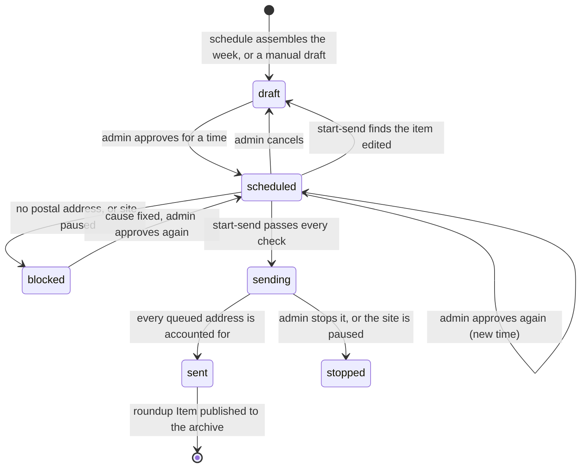
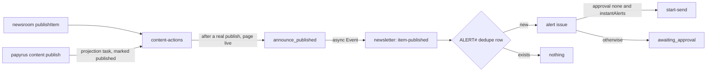

# Newsletter

Status: signup capture is Live. Sending infrastructure is Live for Shipped. The `newsletter` plugin with double opt-in subscriptions is Built (PPY-949d68) but not yet enabled on any site. Unsubscribe, preferences, erasure, bounce and complaint suppression and the pause alarms are Built too (PPY-b5a699), as are roundup issues, admin approval and paced sending (PPY-3ae3b9). Alerts and the newsroom panel are Not built yet.

## What exists

A site can collect newsletter signups. There are two paths. Both only store the address.

### The signup plugin

The `signup` plugin ([plugins.md](plugins.md)) adds a `SignupEntry` model, one guest operation (`submitSignup`), a web component and a "Signups" panel in the newsroom.

- Enable it in the site's `papyrus.config.ts` with `backend: { plugins: ["signup"] }`. The default form is `newsletter`.
- Put the component on a page: `<papyrus-signup form="newsletter" endpoint="..." identity-pool="..."></papyrus-signup>` with the version 1 signup script from `/_plugins/`. The attributes are described in [plugins.md](plugins.md).
- The function checks the address, applies a honeypot field and a minimum fill time, and counts requests per address and identity. A web ACL rate limit is on by default.
- The entry id is a hash of the form and the lower-cased address, so a repeat signup changes nothing.
- Editors and admins read entries; guests cannot read anything.

### The public form endpoint

The built-in public form endpoint ([public-forms.md](public-forms.md)) accepts a post with form id `newsletter` and an `email`. It creates a `Message` with `messageKind: form_submission` and `messageType: newsletter_signup` (`amplify/functions/public-forms/core.ts`). Only editors and admins can read these Messages.

## Listing signups

- Plugin entries: the Signups panel in the newsroom.
- Public form messages: `papyrus messages list --kind form_submission --form newsletter`. Add `--status all` to include handled ones and `--json` for machine output. `papyrus messages handle` marks one handled. See [public-forms.md](public-forms.md).

Email addresses are personal data. Treat them like subscriber records.

## What does not happen today

- The signup plugin and the public form endpoint above send no email. Only the `newsletter` plugin (below) mails a confirmation.
- Only the `newsletter` plugin sends issues (see "Issues, approval and sending"). Nothing in the signup plugin or the public form endpoint does.

## Not built yet

Initiative PPY-31455f plans sending. Its milestones, with what is built:

- M1 (PPY-08dbd8): Amazon SES per site, double opt-in (built, see below), one-click unsubscribe.
- M2 (PPY-19a098): issues composed, approved by an admin and sent once (built, see below).
- M3 (PPY-024f96): automation and alerts (alerts: PPY-d415c0, see Alerts).
- M4 (PPY-df1d54): hardening.

## Email rendering

`papyrus_content.email_render` (pure Python, no network) turns Markus source into a responsive email: HTML with inline styles plus a plain-text alternative.

- `render_issue(subject=, markus=, theme=, footer=, preheader="", site_url=)` renders a marketing issue. The footer carries the reason sentence, a manage link, an unsubscribe link, the site and the postal address. A blank address raises `PostalAddressMissing`.
- `render_transactional(subject=, markus=, theme=, site_name=, site_url=, preheader="", action_url=None, action_label=None)` renders confirmation-style mail with a bulletproof button and a short footer. No address required.
- `theme_from_config(cfg, site_name)` builds an `EmailTheme` from `accent`, `text`, `background` and optional `surface`, `muted`, `fontFamily`, `logoUrl`.
- Markus runs with raw HTML disabled. Relative links and image sources become absolute against `site_url`; links with other schemes than http, https, mailto and tel are unlinked. A fixed tag-to-style map is inlined. The only `<style>` block holds a narrow-screen media query and a dark-mode override. No scripts, external CSS, web fonts or tracking pixels.
- Everything that is not Markus output (subject, preheader, footer fields) is escaped. The subject is collapsed to one line.
- Keep issues under 100 KB of HTML: Gmail clips at 102 KB. A test renders a long sample to guard the markup overhead.
- Preview: `poetry run python -m papyrus_content.email_render out.html` writes `out.html` and `out.txt` for a sample issue.

## Sending stack

Status: Live for Shipped (PPY-874ad4).

Each site that will send newsletters gets its own CloudFormation stack, `papyrus-newsletter-sending-<siteId>`, from `infra/newsletter/papyrus-newsletter-sending.yaml`. It creates the SES identity for the sending domain with Easy DKIM and a custom MAIL FROM domain, the DNS records for them and for DMARC, a configuration set `papyrus-<siteId>` without open or click tracking, and an SNS topic `papyrus-newsletter-events-<siteId>` that carries delivery events. The stack for Shipped sends from `shipped.anth.us`; its identity, DKIM and MAIL FROM checks all pass.

The stack does not send mail and does not lift the SES sandbox. Parameters, the deploy command, verification checks and teardown are in `infra/newsletter/README.md`.

## The newsletter plugin: double opt-in

Status: Built (PPY-949d68), not yet enabled on a site. This is the foundation: the subscriber store, signup and the confirmation email. It stands apart from the `signup` plugin above, which only stores an address.

### Enabling it

Prerequisites: the sending stack for the site is deployed (identity verified, configuration set `papyrus-<siteId>`), and the AWS account is still in the SES sandbox or has production access. In the sandbox SES delivers only to verified addresses, so a confirmation to an ordinary reader is refused until production access is granted. The signup form still answers "check your inbox" (it never reveals delivery), so check the function's logs for `confirmation_send_failed`.

```ts
backend: {
  plugins: [
    {
      name: "newsletter",
      siteId: "shipped",                                   // the sending stack's SiteId
      siteOrigin: "https://shipped.anth.us",               // confirmation links are built on this origin
      computeRoleArn: "arn:aws:iam::<account>:role/<the CmsComputeRoleArn output>",
      sendingDomain: "shipped.anth.us",
      fromAddress: "newsletter@<sendingDomain>",              // a mailbox name at sendingDomain
      fromName: "Shipped",
      instantAlerts: false,                                // must be true before any alert list may use approval: "none"
      theme: { accent: "#...", text: "#...", background: "#...", fontFamily: "...", logoUrl: "https://..." },
      lists: [
        { id: "weekly", name: "...", description: "...", kind: "roundup",
          schedule: { draft: "cron(0 13 ? * FRI *)", timezone: "America/New_York" }, issueType: "newsletter_issue", archivePath: "/roundup/" },
        { id: "alerts-x", name: "...", description: "...", kind: "alert", rule: { sections: ["..."], tags: ["..."], types: ["..."] }, approval: "admin" },
      ],
      // configurationSet and eventTopicName default to papyrus-<siteId> and papyrus-newsletter-events-<siteId>.
    },
  ],
},
```

Invalid settings stop the synth with a readable message: unknown keys, a `fromAddress` off `sendingDomain`, duplicate or malformed list ids, a bad cron or time zone, a roundup without `archivePath`, and `approval: "none"` without `instantAlerts: true`. `schedule`, `issueType`, `archivePath`, `rule` and `approval` are validated now and used by the roundup and alert stories. An alert list with no `rule` matches every published item (an admin still approves each one).

Enabling it is a backend deploy that adds one stack, `newsletter`: a DynamoDB table (retained), a customer-managed KMS key (rotation on, retained), the SSM SecureString `/papyrus/<siteId>/newsletter-key` (generated once, never overwritten, retained) and the `newsletter` Lambda (Python 3.12, arm64, 512 MB, 30 s). It adds no GraphQL model or operation. It publishes `custom.papyrusPlugins.newsletter` (`contract`, `fromName`, list ids, names, descriptions and kinds, `theme`) and `custom.newsletter.actionsFunction` to `amplify_outputs.json`; the CMS routes read both. The IAM role of the function may use the table and its key, read its one parameter, and send mail from `fromAddress` through the site's identity and configuration set only. Only the CMS compute role may invoke it (a resource policy). The CMS app can also take the function name from `PAPYRUS_NEWSLETTER_FUNCTION`.

The plugin needs the CMS app's `/api/*` routes (`app/api/newsletter/*`). They ship with Papyrus, so `papyrus-app sync` adds them to a site repo. A site without the plugin answers 404 on both.

### Routes and form

- `POST /api/newsletter/subscribe`: JSON `{email, lists, page, website, renderedAt, consent, formId}` (8 KB cap, same-origin `Origin` required; `lists` is an array or a comma string). Answers `202 {"status":"check_email"}` for any valid-looking request, `400 {"status":"invalid_email"}` or `{"status":"invalid_lists"}`. A signed-in reader's `siteSubject` is stored with the profile when present; it is never required or logged.
- `GET /api/newsletter/confirm?t=<token>`: a small themed page with a "Confirm subscription" button. It changes nothing, so link scanners are harmless. `POST` (form field `t`) confirms and answers `303` to `GET /api/newsletter/confirm?done=1&l=<listIds>`, which names the lists. An expired or used link shows a page linking back to the site.
- Web component `/_plugins/papyrus-newsletter@1.js` (written to the site bucket when the plugin is on):

```html
<script src="/_plugins/papyrus-newsletter@1.js" defer></script>
<papyrus-newsletter lists="weekly,alerts-x"
  consent="I agree to get the weekly email and alerts, and can unsubscribe at any time."></papyrus-newsletter>
```

Attributes: `lists` (comma separated list ids), `data-lists` (JSON array of `{id,name,description}` taken from `custom.papyrusPlugins.newsletter.lists`, labels the checkboxes; or set `window.papyrusNewsletter = { lists }` once), `consent` (the sentence shown and stored as evidence), `endpoint` (default `/api/newsletter/subscribe`), `form-id`, `label`, `button`, `success`. One list: no checkbox. Several: unticked checkboxes, at least one required. No inline script or style attribute, so it works under a strict CSP.

### What subscribing does

The answer is `check_email` whatever the site knows about the address. A bot (filled `website` field, or a form submitted within 2 s or after 24 h) is accepted silently and nothing happens. Rate limits: 5 per visitor address per 10 minutes, 3 per subscriber per hour, 300 per site per hour; a limited request is still answered `check_email`, sends nothing and logs a CloudWatch EMF metric (`SubscribeRateLimited`, dimension `Scope`). A suppressed address gets nothing.

- New address: a `pending` profile with the consent evidence (`requestedAt`, `formId`, `pageUrl`, the exact wording the form showed, a keyed hash of the visitor address), `pending` list rows, a fresh nonce, and the confirmation email. Pending profiles expire after 30 days (DynamoDB TTL).
- Pending (or unsubscribed) address: a fresh nonce and list set replace the old ones, the earlier link stops working, and the confirmation is resent.
- Confirmed address asking for a new list: a confirmation for only the new lists. Nothing new: nothing happens.
- Confirming (the POST): the token must be valid, unexpired (72 hours) and carry the profile's current nonce, which is cleared at once, so a link works once. The profile becomes `confirmed` (with `confirmedAt`, the confirming IP and user agent), the list rows become `subscribed` with `gsiList` set, and the response includes a manage token for the later preferences story.

The confirmation email is built by `email_render.render_transactional` (theme from the plugin's `theme`), sent with SESv2 from `"<fromName>" <fromAddress>` with the configuration set and the tags `site` and `kind=confirm`.

### Data model

One DynamoDB table (not a GraphQL model; subscriber data never appears in the content API). Keys `pk`, `sk`; TTL `expiresAt`; GSI `byList` on `gsiList` + `sk` (keys only); on demand; customer-managed KMS key; point-in-time recovery off so erasure is real.

| pk | sk | Holds |
|---|---|---|
| `SUB#<hid>` | `PROFILE` | `email` (normalized), `status` pending / confirmed / unsubscribed, `createdAt`, `updatedAt`, `rev`, `siteSubject?`, `confirmNonce?`, `consent` {`requestedAt`, `formId`, `pageUrl`, `wording`, `requestIpHash`, `confirmedAt`, `confirmIp`, `confirmUserAgent`}, `history` [{`at`, `event`}] capped at 50 |
| `SUB#<hid>` | `LIST#<listId>` | `status` pending / subscribed / unsubscribed, `at`; `gsiList` = list id only while subscribed on a confirmed profile |
| `SUPP#<hid>` | `SUPP` | suppression (`reason`, `at`); checked before every send. Written by a later story. |
| `RATE#<kind>#<key>#<window>` | `RATE` | request counters with TTL |

`hid` = hex(HMAC-SHA256(hashKey, lowercased trimmed address))[:32]. A profile is replaced only if its `rev` is the one that was read, in one transaction with its list rows. `hashKey` and the token key are HKDF-SHA256 derived (salt `papyrus-newsletter`, info `hash` / `token`) from the SSM parameter, which the function reads once per container. Later stories add `ISSUE#`, `ALERT#`, `ROUNDUP#` and `STATE` rows to the same table.

### Tokens

`v1.<base64url(json)>.<base64url(hmac-sha256)>`, the HMAC over `v1.<base64url(json)>` with the token key, compared in constant time. The JSON holds `h` (hid), `p` purpose (`confirm` or `manage`), optionally `l` (list ids), `n` (nonce) and `e` (expiry, epoch seconds). Confirm tokens carry `n` and `e` (72 hours) and are single use. Manage tokens (for the unsubscribe and preferences stories) have no expiry and die with the subscriber record.

### Unsubscribe, preferences and erasure (PPY-b5a699)

Status: Built, not yet enabled on a site.

- **Links.** `papyrus_content.newsletter.links` exports `make_manage_token(hid)` and `manage_urls(hid, list_id=None)` for the sender. `manage_urls` returns `{"manage_url": <origin>/api/newsletter/preferences?t=<token>, "unsubscribe_url": <origin>/api/newsletter/unsubscribe?t=<token>[&l=<listId>]}`. Both read `KEY_PARAMETER` and `SITE_ORIGIN` from the environment (or take `keys=` and `site_origin=`). No address ever travels in a link. Confirming a subscription returns a manage token, and the confirmed page links to the preferences page with it.
- **`POST /api/newsletter/unsubscribe?t=&l=`** accepts RFC 8058 one-click: a POST from a mail provider's servers with the body `List-Unsubscribe=One-Click`. It has no same-origin check, accepts any content type, answers `200` with `Unsubscribed.` and is idempotent (a repeat, or a token whose subscriber was erased, still answers 200; an invalid token is 400). A POST needs that marker or `page=1` from our own page. `GET` shows a themed page with a POST button and changes nothing; the POST from that page answers a page that says "You are unsubscribed" and links to preferences.
- **`/api/newsletter/preferences`.** `GET ?t=` lists every list with a tick for the ones the subscriber has, with the address masked (`r***@example.com`). The same-origin form `POST` has three buttons: save (the ticked set becomes the subscription), unsubscribe from everything, and delete my data, which first shows a confirm page. Ticking a list again re-subscribes with no new opt-in, because the manage token proves control of the inbox. If the address was suppressed for a bounce or complaint, a deliberate re-subscribe removes the `SUPP#` row and the address from the SES account suppression list (`DeleteSuppressedDestination`); a manual suppression is never lifted this way.
- **Function actions** (added to the dispatch table): `preferences_state`, `update_preferences`, `unsubscribe` (token, optional list; none means all), `delete_subscriber` (token), `admin_erase` (email, for the newsroom panel) and `resume_sending`. The last two do no authorization themselves: only the CMS compute role can invoke the function, and the public routes never send them. The newsroom story must check the admin group before calling them.
- **Erasure** removes `PROFILE`, every `LIST#` row, the `SUPP#` row and every send-ledger row of the subscriber. Ledger rows are found through the sparse GSI `byHid` (partition key `gsiHid`, keys only): the sender must write `gsiHid = <hid>` on every `ISSUE#<id>` / `SEND#<hid>` row (`records.LEDGER_HID_ATTRIBUTE`). That costs one attribute per row and no second write, where a profile list of issue ids would cost an update per send. Rate counters (2 hours) and the event log (90 days, below) expire by TTL.
- **Suppression.** `suppression.is_suppressed(hid)` is for the sender, as is `pause.is_paused()`. The confirmation email carries the `sub` tag too, so a permanent bounce of a confirmation also suppresses.

### SES events and the pause

The plugin stack subscribes the function to the sending stack's SNS topic (`papyrus-newsletter-events-<siteId>`, by literal name; the sending stack must exist first). Events map back to a subscriber with the message tags `sub` (subscriber id), `issue` and `list`; an event with no valid `sub`, from another site, or of another type (Send, Open, ...) is ignored.

| Event | Effect |
|---|---|
| Bounce, Permanent | `SUPP#` row (`bounce`), unsubscribe from every list, history entry; with an `issue` tag the ledger row becomes `bounced` and `counts.bounced` goes up |
| Bounce, other types | counted only (`counts.softBounced`); nothing else changes |
| Complaint | `SUPP#` row (`complaint`), unsubscribe from every list; ledger `complained`, `counts.complained` |
| Delivery | ledger `delivered`, `counts.delivered` (never overwrites a bounce or complaint) |
| Reject, Rendering Failure | ledger `failed`, `counts.failed` |

Ledger and counter updates are conditional and happen once per change, so duplicate notifications count once and a missing ledger row or issue is a no-op. Every handled event also writes a row `EVENTS` / `<iso>#<messageId>#<type>` with only the subscriber id, type, issue, list and bounce type, which expires after 90 days; the newsroom history will read these.

Two CloudWatch alarms (`papyrus-newsletter-<siteId>-bounce-rate`, `-complaint-rate`) evaluate `IF(sent >= 50, FILL(events, 0) / sent, 0)` over a 24 hour period on the metrics `Send` and `Bounce` or `Complaint` (namespace `AWS/SES`, dimension `ses:configuration-set` = the configuration set, written by the sending stack's CloudWatch destination). Thresholds are 4% bounces and 0.08% complaints; missing data does not alarm. They notify the SNS topic `papyrus-newsletter-alarms-<siteId>`, which invokes the function. On ALARM the function turns the configuration set's sending off (`PutConfigurationSetSendingOptions`, IAM limited to that set) and writes `STATE` / `SITE` `{paused: true, reason, pausedAt}`; `resume_sending` turns both back. The metric names follow the SES documentation for CloudWatch event destinations and were not checked against a live account.

### Live check with the mailbox simulator

`python -m papyrus_content.newsletter simulate --site-id <id> --from-address <address on the sending domain> --from-name <name> --outcome success|bounce|complaint --hid <32 hex subscriber id> [--issue <id>] [--list <id>]` sends one tagged test message through the site's configuration set to the matching Amazon SES mailbox simulator address, so no inbox is involved. `--dry-run` prints the request. Run it with credentials that may send from the identity, then look for the `EVENTS` row, the `SUPP#` row and the ledger update.

### Known gaps

Not built: the newsroom panel (its story). The sender (PPY-3ae3b9) writes `gsiHid` on every ledger row, as above, so erasure finds them. Events carry the subscriber id, a pseudonym, so the 90 day event log is not erased with the subscriber; it expires. A form left open more than 24 hours is accepted silently and sends nothing; the reader has to reload and try again.


## Issues, approval and sending

Status: Built (PPY-3ae3b9). The newsroom panel that drives it is a later story; until then the operations below are the interface.

A roundup issue is an `Item` of the list's `issueType` (default `newsletter_issue`), so editors write it in the ordinary newsroom editor (open it at `/newsroom/articles/<itemId>`; the article list does not show other types yet). The newsletter table holds its send state in `ISSUE#` rows. When the send finishes, the Item is published through `content-actions` (`publishItem`), so the standard front end gives it a page, a Markdown twin and an `llms.txt` entry, and lists it on the archive page.

### Issue lifecycle



`awaiting_approval` and `cancelled` belong to alerts (below). A `blocked` issue is fixed at its cause (configure the address, resume the site) and approved again.

### Archive: what a site puts in projection.json

The projector decides a page by section, and which Item types it projects by `listings.types`. A site archives its roundup with exactly this, where `roundup` is the last segment of the list's `archivePath` (`/roundup/`) and `newsletter_issue` is its `issueType`:

```json
{
  "urls": {
    "style": "directory",
    "sections": {
      "roundup": { "base": "roundup", "label": "Roundup", "description": "Every weekly issue.", "feed": false }
    }
  },
  "listings": { "types": ["article", "newsletter_issue"] }
}
```

Core change (PPY-3ae3b9): until now only `article` and `page` Items were projected whatever the settings; the projector now also projects every type in `listings.types` (`StandardMarkusProjector.projectable_types`, `PublishedContentSource.extra_types`). Sites that do not list a type project nothing for it, as before. `feed: false` keeps issues out of the site feed. The plugin setting `itemUrlStyle` (`html`, `directory` or `clean`, default `html`) must equal `urls.style`: roundup drafts link to published items with it. `archivePath` is one path segment because it is also the Item section and the `urls.sections` key.

Item `type` is a free string in the Item model and in `saveItemDraft`; the newsroom article editor's Type menu offers only `article` and `page` and its list loads only those types, so an issue is opened by id. Epic PPY-cf5e4c (publication-defined shapes) names "newsletter issue" as a shape; `newsletter_issue` is that string.

### Drafting the roundup

Each roundup list gets an EventBridge Scheduler schedule (`CfnSchedule`) from `schedule.draft` in `schedule.timezone`, which invokes `newsletter` with `{"task":"assemble-roundup","listId":...}`. The task:

- takes the published, non-issue Items published after the last sent issue of that list (else the last seven days);
- writes a draft Item titled `<list name>: <date range in the schedule's time zone>` in section `<archive segment>`, slug the local date, whose Markus body is an intro placeholder line followed by the items grouped by section (linked title, then the front matter description, summary, dek or standfirst);
- writes the `ISSUE#<issueId>` row (`draft`, kind `roundup`, `itemId`, subject = title);
- is idempotent per list and ISO week through `ROUNDUP#<listId>` / `PERIOD#<yyyy-ww>` (a conditional put; a claim whose issue row was never written is finished on retry);
- writes nothing when the window has no items (it logs `roundup_empty`).

No LLM is involved. Section headings are the Item section names, capitalised; links use `<siteOrigin>/<section>/<slug>` in the site's URL style.

### Operations (for the newsroom panel)

Eight Amplify custom operations, all `input: AWSJSON` in and `AWSJSON` out. AppSync admits the groups below; the function checks the identity claims again. They enter through a thin function (`papyrus-newsletter-ops`) that forwards the verified claims and the input to `newsletter`. The recipient of a test send is the caller's own `email` claim, never the input.

| Operation | Kind | Groups | Input | Output |
|---|---|---|---|---|
| `newsletterIssues` | query | editor, admin | `{listId?, status?, limit?}` (limit 1 to 200, default 50) | `{ok, issues: [Issue]}` newest first |
| `newsletterIssue` | query | editor, admin | `{issueId}` | `{ok, issue: Issue + contentHash?, editedSinceApproval?}` |
| `newsletterPreview` | query | editor, admin | `{issueId}` | `{ok, subject, html, text, bytes, postalAddress, contentHash}` (footer links are `#preview`) |
| `newsletterApproveIssue` | mutation | admin | `{issueId, sendAt}` ISO 8601 | `{ok, issue, adjusted, warnings: []}` |
| `newsletterCancelIssue` | mutation | admin | `{issueId}` | `{ok, issue}` |
| `newsletterStopIssue` | mutation | admin | `{issueId}` | `{ok, issue}` |
| `newsletterTestSend` | mutation | editor, admin | `{issueId}` | `{ok}` |
| `newsletterCreateDraft` | mutation | editor, admin | `{listId}` (a roundup list) | `{ok, status: "created", issueId, itemId, items}` |

`Issue` is `{issueId, listId, listName, kind, itemId, subject, status, sendAt, approvedBy, approvedAt, sentAt, counts: {queued, sent, failed, suppressed, skipped, delivered, bounced, complained}, note, archiveUrl, createdAt, updatedAt}`; absent fields are omitted. `sendAt` is stored in UTC. A failure is `{ok: false, error, message}` with `error` one of `forbidden`, `not_found`, `invalid_state`, `item_missing`, `render_failed`, `bad_request`, `no_address`, `postal_address_missing`, `unavailable`.

Approval renders the Item's current Markus body (a body that does not render is refused), stores `contentHash` (sha256 of the subject, a blank line and the body) and creates the one-time schedule `papyrus-nl-<siteId>-<issue8>` at `sendAt` (UTC, `ActionAfterCompletion: DELETE`, flexible window off). A `sendAt` in the past or under two minutes ahead becomes now plus two minutes (`adjusted: true`). Approving again updates the same schedule. `warnings` says so when the postal address is not configured yet. Cancelling deletes the schedule and returns the issue to `draft`.

### Sending

`start-send` (fired by the schedule) re-validates, in this order, and does nothing else if any check fails:

1. The status is `scheduled`.
2. The content hash is unchanged. If not, the issue goes back to `draft` with the note "edited after approval; approve again" and nothing is sent.
3. The postal address resolves (below). If not: `blocked`, note "postal address missing".
4. The site is not paused. If it is: `blocked`, note "site paused".

Then it renders the issue once (the reason sentence, the postal address and a manage and an unsubscribe link placeholder), stores the HTML and text on `ISSUE#<id>` / `RENDER`, sets `sending` and `counts.queued`, and sends every subscriber id from the list's `byList` index to the SQS queue in messages of up to 50 (`{issueId, hids}`).

The worker (`papyrus-newsletter-send-<siteId>`, SQS batch size 1, reserved concurrency 1, timeout 180 s, queue visibility timeout six times that, three receives then the dead letter queue) handles a message like this:

- the issue is reloaded; if it is no longer `sending` (stopped, blocked) the message is dropped, and the site being paused stops the issue;
- for each subscriber id: `suppressed` if suppressed, `skipped` if the profile is not confirmed or the membership is not subscribed (both are written to the ledger and counted once);
- otherwise the ledger row `ISSUE#<id>` / `SEND#<hid>` is created with `attribute_not_exists` **before** SES is called. A failed condition means it was handled: a row still `claimed` (a worker died after claiming) is counted `failed` with error `interrupted` and never mailed;
- SESv2 `send_email` with Simple content, `List-Unsubscribe: <unsubscribe URL>` and `List-Unsubscribe-Post: List-Unsubscribe=One-Click`, the configuration set and the tags `site`, `list`, `issue`, `sub` (= the subscriber id); a throttled call sleeps 1, 2 and 4 seconds and tries again; any other error is recorded as `failed` with its code;
- the row becomes `sent` (with the SES message id) or `failed`, and `counts` is incremented, in one transaction;
- calls are spaced to the account's `MaxSendRate` (from `sesv2 get_account`, cached five minutes, never below one a second);
- when too little time remains, the unprocessed ids go back to the queue as a new message;
- when `sent + failed + suppressed + skipped` reaches `queued` the issue becomes `sent` through a conditional update, so exactly one invocation completes it. A roundup is then published (the archive); if that fails the issue stays `sent` and its `note` says to publish the Item from the newsroom.

SES custom headers need a boto3 whose SESv2 model has `Simple.Headers`; the function bundles `boto3>=1.35.8` and a test fails if the installed one lacks it.

### Test send

`newsletterTestSend` mails one copy to the signed-in editor's own address: subject prefixed `[Test]`, the real footer with non-working `#test` links, no unsubscribe headers, no ledger row, and only the tags `site` and `kind=test`. It still needs the postal address.

### Postal address

Read at send time from SSM String parameters: `/papyrus/<siteId>/email/postal-address` first, else `/papyrus/email/postal-address`, cached five minutes. The functions may read exactly those two parameters. Neither, or a blank value, blocks issue sends and approval says so in `warnings`. The value is never stored in the repository, logged or put in a test. Tests use a placeholder.

### Operator notes

- Environment (all set by the plugin): `FUNCTION_ARN`, `SCHEDULER_ROLE_ARN`, `QUEUE_URL`, `CONTENT_ACTIONS_FUNCTION`, `PAPYRUS_GRAPHQL_ENDPOINT`, `ITEM_URL_STYLE`, plus those of the double opt-in. `LISTS_JSON` also carries a roundup's `issueType`, `archivePath` and `timezone`.
- IAM: `newsletter` may create, update and delete schedules named `papyrus-nl-<siteId>-*`, pass the one scheduler role, send to the queue, read the two postal parameters, invoke `content-actions`, and call five AppSync fields (`Query.getItem`, `Query.getPublishedItem`, `Query.listPublishedItems`, `Mutation.createItem`, `Mutation.updateItem`). The worker may read and write the table, receive from and send to the queue, invoke `content-actions`, read the key parameter, send through the site identity and configuration set, and call `sesv2:GetAccount` (no resource-level form exists). The AppSync function may only invoke `newsletter`.
- To stop a send in progress, an admin calls `newsletterStopIssue`: workers drop the remaining messages and the counts stay as they were.
- A message in the dead letter queue (`papyrus-newsletter-send-<siteId>-dlq`) is a batch that failed three times (a missing render, SES unreachable). The ledger makes it safe to redrive: addresses already handled are skipped.
- A `blocked` issue needs its cause fixed (create the postal address parameter, resume the site) and an admin to approve it again; approval accepts `blocked`.

### Known gaps

- Reserved concurrency 1 on an SQS-fed function can make Lambda poll while the function is busy; those throttled receives count toward the three before the dead letter queue. Watch the dead letter queue on the first large send; a larger `maxReceiveCount` or chaining messages (each message enqueues the next) removes the risk.
- The window is read by scanning the published item summaries (as the projector does); a very large site may want an index by publish time.
- Link paths assume a section's `base` equals its name. A section declared with another `base` would be linked wrongly in a draft (the editor fixes the link).
- The article list in the newsroom does not show issue types; the panel links to the editor by item id.
- `compliance.py` binds the unsubscribe story's `links`, `suppression` and `pause` calls to the sender's store and keys.

## Alerts: publish-triggered (PPY-d415c0)

Status: Built. An alert list sends one short email when a matching item is published. Alerts hang off the Papyrus publish event and nothing else: not procedure runs, not monitor triggers.

### Configuration

```ts
newsletter: {
  // ...as above
  instantAlerts: false,            // true lets a list with approval: "none" send without an admin
  lists: [
    // Every published item, approved by an admin.
    { id: "all-alerts", name: "All alerts", description: "...", kind: "alert", approval: "admin" },
    // Items in either section, with a matching tag, of one type; OR within a field, AND across the fields present.
    {
      id: "rulings", name: "Rulings", description: "...", kind: "alert", approval: "none",
      rule: { sections: ["rulings", "notes"], tags: ["breaking"], types: ["article"] },
    },
  ],
}
```

`rule` is optional; absent or empty it matches every published item. Names compare without regard to case. A section is the item's section, a tag comes from the `tags` front matter, and a type is the item type. Items of any roundup list's `issueType` never raise an alert.

### How a publish reaches the newsletter



`src/papyrus_content/publish_alerts.py` (`announce_published`) is the only code that invokes the newsletter function, from `content-actions`. It fires only for a real publish (`PublishResult.changed`), never for unpublish, edits that keep the same published content, or reprojection (`all`, `item-pages`, `deploy-render`):

- Newsroom: `publish_item_action` passes the published item id to `project_item_action` when `changed`. The announcement goes out once the page is live. If the projection failed, the scheduled retry carries the same marker and announces when it succeeds.
- CLI: `papyrus content publish` marks its projection task with the published item id when `changed`; `run_projection_task` announces after the projection succeeds. A task without the marker (a plain reprojection, `--no-trigger`, an unchanged republish) announces nothing.
- No `PAPYRUS_NEWSLETTER_FUNCTION` (the plugin is off): a no-op. Any error is logged and swallowed, with 2 and 3 second timeouts, so an alert problem never fails or slows a publish.

The plugin sets `PAPYRUS_NEWSLETTER_FUNCTION` on `content-actions` and grants it `lambda:InvokeFunction` on `papyrus-newsletter-<siteId>` only.

### What the function does

For each alert list whose rule matches, `alerts.py` takes a conditional-put dedupe row `ALERT#<listId>` / `ITEM#<lineageId>` (kept, never expired) and, if it was new, writes an issue of kind `alert` with `sourceItemId` and `lineageId`. A repeated event, a republish or an edit therefore never alerts again; a crash between the dedupe row and the issue is finished by the retry. No Item is created and there is no archive. The subject is the item title; the Markus body, stored on the issue row, is the title as a link, the dek (`deck`, or a `description`/`summary` style front matter field), the item's first paragraph of plain prose if it has one, and a "Read it on <site>" link. Links use `ITEM_URL_STYLE` as roundup drafts do. The footer says "You get this because you subscribed to <list name> alerts on <site>."

An alert starts `awaiting_approval`; the admin approves it (`newsletterApproveIssue`), which schedules it like a roundup. Cancelling an alert (waiting or scheduled) ends it as `cancelled`; it does not return to draft. If the list has `approval: "none"` and the site has `instantAlerts: true`, the function approves it as `system:instant-alert` and calls `start-send` at once, so the content-hash, postal address and paused-site guards still run (a failure leaves it `blocked` for an admin). When an alert finishes `sent`, nothing is published.

### Known gaps

- Only `publishItem` (the newsroom action and the CLI) alerts. `saveItemDraft` on an already-live item, `papyrus story` commands and imports publish without an alert, on purpose: a bulk import must not alert.
- A CLI publish with `--no-trigger`, or on a site with no projection and no `content-actions` function configured, does not alert.
- A site that publishes an item before the matching alert list exists gets no alert for it (the event has passed).
- The alert shows no admin notification; the panel shows pending alerts.
