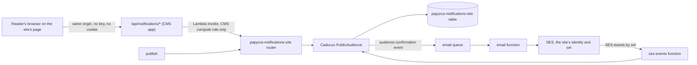

# Public audiences: subscribe and manage pages working end to end

Status: designed 2026-11-12 (PPY-1081ad, epic PPY-824c14). Caducus side released in Caducus 0.3.0 (AnthusAI/Caducus #15, #16). Papyrus side: this plugin pins it. Public sending stays off on every site until the forced pause drill below passes. Nothing is deployed, released or sent.

Ryan decided (2026-11-12) that every notification, newsletters and subscriptions included, goes through one Caducus setup. Today the `/api/notifications/*` routes answer `503 unavailable` because Caducus had no public audiences. This plan fixes that at its cause, in Caducus, and deletes the 503 path. The package side, with the data model, the abuse limits and the lifecycle in full, is [`docs/public-audiences.md` in AnthusAI/Caducus](https://github.com/AnthusAI/Caducus/blob/develop/docs/public-audiences.md). This page is the Papyrus side and the decisions that span both.

## The shape



- **Caducus owns subscribers and consent.** Readers, lists, consent evidence, suppression, tokens and limits are Caducus rows in the site's notifications table. Papyrus holds only the audience's settings (lists, consent wording, confirm window) in `papyrus.config.ts` and maps routes to Caducus calls. The plugin writes no subscriber row itself and has no stub store and no fallback to the newsletter plugin.
- **No public API.** The browser talks only to the site's own origin: the reader pages under `<base>/notifications/` and the machine routes `/api/notifications/*`, both behind the site's CloudFront. So there is no API key in the browser, no CORS (same origin), no cookie, and the strict CSP stays as it is (external scripts from `/_plugins/`, no inline script). The routes invoke the site's own router function, which only the CMS compute role may invoke.
- **Origin check** stays in the routes (`lib/notifications-api.ts`): `Origin` must equal the site origin, or a same-origin `Referer` when there is no `Origin`; `Origin: null` is refused. The RFC 8058 one-click POST is the one exception, because mail providers post from their servers.

## Public surface

| Route | Who | Does |
| --- | --- | --- |
| `GET /api/notifications/state?kind=offered` | the subscribe component | the site's lists and the consent wording, from settings; reads no reader data |
| `POST /api/notifications/subscribe` | the component | JSON `{email, lists, consent, formId, page, website}`; `202 check_email`, `400 invalid_email / invalid_lists / invalid_consent`, `429 slow_down` |
| `GET /api/notifications/state?kind=confirm&t=` | the confirm page | list names for the token |
| `POST /api/notifications/confirm` | the confirm page's button | confirms; `303` to `confirmed` (with a manage token) or `expired` |
| `GET /api/notifications/state?kind=preferences&t=` | the preferences page | masked address and lists on or off |
| `POST /api/notifications/preferences` | the preferences page | save, unsubscribe from everything, delete my data (after a confirm step); `303` |
| `POST /api/notifications/unsubscribe?t=&l=` | mail providers (one click) and the unsubscribe page | `200 Unsubscribed.` for one click, `303` for the page |

A `GET` on any machine route changes nothing and redirects to the page, because mail scanners fetch links. People never land on `/api`; failures they can see are 303s to the site's `expired` page, never 403 or 404 (the edge rewrites those to the site's 404).

`429 slow_down` is new: the network limit refuses with words a person can act on ("Too many signups from your network just now. Try again later."), since it says nothing about any address. The subscribe component shows it in words; the pages already say 502 and 503 in words.

## Consent wording must match the form

The plugin gains one setting, `consent`: the sentence the form shows. `kind=offered` returns it, the component renders exactly that text (no `consent` attribute, no default in the script), and posts it back. Caducus refuses a subscribe whose wording differs (`invalid_consent`), stores its hash with the consent record, and keeps the text once per distinct sentence. Changing the sentence is a config change; earlier subscribers keep the evidence of what they saw.

## Abuse controls

No CAPTCHA (we cannot run one we trust, and it shuts out readers). Instead, from cheapest to last resort: the origin check; the hidden `website` field; address syntax and a DNS check that the domain takes mail, before any mail is sent; one outstanding confirmation per address, with a resend gap learned from how fast this site's readers confirm; a per-network limit learned from this site's own signups (a Poisson tail test whose bound keeps expected wrongful refusals over the site's history under one); a surge notice to admins instead of a block for the whole site; and the bounce and complaint pause. The details and the reasoning are in the Caducus design. The newsletter plugin's fixed limits (5 per visitor per 10 minutes, 3 per subscriber per hour, 300 per site per hour) and its client-supplied fill-time check are not carried over.

## Configuration

```ts
{
  name: "notifications",
  // ...the existing settings (siteId, siteOrigin, basePath, sendingDomain, fromAddress, fromName, theme)
  consent: "I agree to receive the emails I choose from Example News and can unsubscribe at any time.",
  confirmWindowHours: 72,   // how long a stranger's address is held unconfirmed and the link works; 72 is the newsletter's promise today
  lists: [
    { id: "stories", name: "New stories", description: "One email per new story.", rule: { sections: ["News"] } },
  ],
}
```

Every list carries the kind `story.published` today; the weekly issue adds its own kind with PPY-4108ef, and the list setting that names it comes with that story. The kind `story.published` becomes class `public` (it was `operator`): its audience is the confirmed subscribers of the lists whose rule matches the story, so the SSM operators parameter no longer receives new stories.

## Plugin changes

- **Table:** one new GSI, `byList` (partition `gsiList`, keys only). It is the only new index in this deploy.
- **Router function:** the reader actions call Caducus `handlers.public.dispatch`. `src/papyrus_content/notifications/public.py` loses its 503 answer. Erasure and export for admins are function actions the public routes never send; the newsroom panel that calls them, with the admin group checked, is part of PPY-6b2d35.
- **Email:** the themed renderer renders the confirmation (a button to the confirm page) and puts the manage and unsubscribe page links in the footer of public mail; the mailer passes the RFC 8058 headers through the site mailer from PR #1427.
- **SES events:** the handler from PR #1427 also calls Caducus `provider_event`, so a permanent bounce or a complaint suppresses the reader.
- **Pages (PR #1430):** connected to the real routes (the `offered` consent, `slow_down` in words). They merge only after the function stops answering 503, so pages never ship over a dead function.

## Sending identity and the pause

Mail goes out as the site, through its own SES identity and configuration set `papyrus-<site>` (PR #1427, PPY-c522bf). The pause switch is that set's sending switch: the site's bounce and complaint alarms (4% and 0.08% over 24 hours, below SES's 5% and 0.1% review lines and Gmail's 0.3% spam limit) turn it off, and so can an operator. Public mail needs the postal address in SSM (CAN-SPAM); without it a public delivery fails with a reason. Outward mail needs the site to list the plugin (an explicit opt-in per site), the readiness check of PPY-a85725 before any signup placement shows, and for issues, an admin's approval (PPY-4108ef).

## The pause assumption, and the drill that must pass first

The site's pause is its configuration set's sending switch (PR #1427, held on purpose). One part of it rests on a guess not yet seen on a live account: that SES refuses `SendEmail` through a disabled configuration set with the code `SendingPausedException`.

| What | Rests on the guess? | If the guess is wrong |
| --- | --- | --- |
| The alarms turning sending off (`PutConfigurationSetSendingOptions`) | No (documented call) | A failed call errors the pause function, whose alarm reaches operators |
| A refused send recorded `failed` "sending is paused" and not retried | Yes | A different code is not recognised: the claim is released, the delivery stays `queued`, SQS retries, and the message ends in the dead letter queue, whose alarm reaches operators. Nothing is sent, nothing is lost silently |
| SES actually refusing mail through a disabled set | The pause itself | Only the drill can show this; if SES accepted, the public send path stays Off |

Either SES refuses (and the refusal is recorded or dead-lettered), or the drill shows otherwise and nothing is turned on. **Before any site's public send path is On**, a forced pause drill runs on a test configuration set with the SES mailbox simulator (PPY-a85725): turn sending off, send to the simulator, record the exact error code and see the delivery `failed` with the pause reason (if the code differs, correct `SiteMailer` and repeat), turn sending on and see the next send go out. Until it passes, no site lists the plugin with readers' lists (the operator steps below list it first).

## Privacy

- Subscriber records are personal data: in the notifications table only (customer-managed KMS key, no point-in-time recovery so erasure is real), readable only by the notifications functions, never by AppSync, the guest or editor content API, or the newsroom except through admin-only export and erasure.
- Consent evidence: the wording (hash plus the stored text), the form id, the page path without its query, the origin, a keyed hash of the visitor's network (/24 or /48, never the IP), a truncated user agent, and the request and confirmation times.
- GDPR: access by admin export, erasure by the reader (preferences page) or an admin, consent kept as evidence. CAN-SPAM: postal address in every public message, unsubscribe honoured in the same request, links that keep working (manage tokens never expire). Consent text per language is later.
- No tracking pixel, no open or click tracking, no address or token in any link parameter other than the token itself, no address in any log line.

## Analytics

GA4 events fire from the pages only, under the site's Consent Mode, never from the server, and there is no `issue_open` (PPY-5a1607): `subscribe_start`, `subscribe_submitted`, `subscribe_confirmed` (once per load), `preferences_changed`, `unsubscribe`, `subscribe_error`, with `kind`, `form`, `page_type` and never an address, token or query string. That story builds the script; nothing in this plan sends analytics.

## Existing newsletter subscribers (PPY-6b2d35)

Shipped and Distinctive Mark keep the newsletter plugin until each moves, in a send freeze agreed per site. The move uses Caducus `import_subscriber`: each confirmed subscriber gets the same lists (the roundup list becomes the issue kind's list), its original consent evidence copied and marked `migrated`, no confirmation mail; bounced and complained addresses arrive suppressed; an erased address is never re-imported. A dry run prints counts per list, consent coverage and suppressed addresses; the real run is idempotent and its counts must match.

Old links in mail already sent keep working for a dated period: the migration writes Caducus aliases (`ALIAS#papyrus-newsletter#<old subscriber id>`) with a TTL at the retirement date, and the newsletter's `/api/newsletter/unsubscribe` and preferences routes resolve old tokens through them into Caducus. When the date passes the aliases vanish by TTL, and the release after it deletes the old-link code and the newsletter plugin's subscriber code together. Proposed date: 30 days after each site's last old-format email, the period CAN-SPAM requires an opt-out to keep working. Ryan decides (open question on PPY-6b2d35).

## Increments

1. **Caducus**: public audience model, subscribe, confirm, preferences, unsubscribe, suppression, erasure, export, import and aliases, learned limits, fan-out by list, RFC 8058 headers. Behave features on fakes and a fake SES; moto for the store. Merged to develop, then released (a minor version).
2. **Papyrus**: pin the Caducus release; the plugin's settings, GSI and dispatch; renderer and headers; SES events; Gherkin (`features_backend/notifications-public-audience.feature`); docs. Builds on PR #1427.
3. **Pages**: PR #1430 connected to the real routes and merged after increment 2.
4. Then, outside this story: the migration (PPY-6b2d35), the issue kind (PPY-4108ef), readiness (PPY-a85725), the MoM launch (PPY-f4b164).

## Rollback

Nothing reaches readers until a site lists the plugin with lists and the signup placements show (PPY-f4b164 gates that on readiness). Rolling back a site is removing its signup placements and pages in one deploy; the table is retained, so no consent evidence is lost. Turning sending off for a site at once is the configuration set's switch.

## Operator steps (none done by this work)

Per site, before signup opens: the forced pause drill above (once, on a test configuration set); the SES identity and configuration set (`infra/newsletter/`), with an event destination to the default bus; the postal address parameter; DMARC published through the Git template once the report mailbox exists (PPY-6bcae9); the readiness drill (PPY-a85725); then one backend deploy carrying the plugin settings and the Papyrus version that pins the Caducus release.
