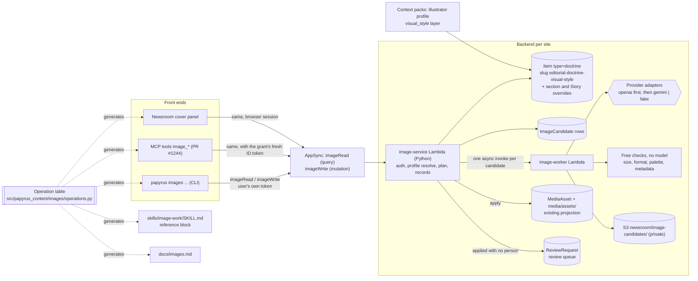

# Papyrus image toolchain: design

Status: design only, 2026-11-07, revised the same day after Ryan's review (no paid image checks, one image when unattended, OpenAI first) and again with his answers (trial of `gpt-image-2.5-flare` on Machines on Machines approved, Batch where nobody waits, subtle reader credit, per-site review setting, warn without a profile, style entirely in data). No code, PRs, paid calls or AWS writes were made. Read from `origin/develop` at `7c9bef69`, PR #1244's head `64697bdb`, the Kanbus board, and the Machines on Machines checkout.

Epic: PPY-0111742e. Profile story: PPY-e4bdd096. Stories it builds on: PPY-40b7a4 (CLI), PPY-8553c6 (search and select), PPY-8ea0f1 (MCP), PPY-a52989 (newsroom picker), PPY-c101a6 (provider interface). The provider and model decision stays with PPY-f0af42 and PPY-ff3780.

---

## 1. What exists today

### Built and live on develop

| Piece | Where | What it does |
| --- | --- | --- |
| Cover picker (stock) | `components/cover-image-picker.tsx`, `lib/stock-images/*`, `app/api/newsroom/stock-images` | Four Wikimedia Commons pictures at a time, reload, search words or a target worked out from the Story (`search-target.ts`), Accept or give up. Runs in the newsroom's Next server, editor or admin only. |
| Source interface | `lib/stock-images/types.ts` | `StockImageSource { search, lookup }`, `StockCandidate`, `CoverImageRecord`. Its comment already says "generated images later can implement the same two calls". Licences allowed: public domain, CC0, CC BY (`licences.ts`). |
| Applying a cover | `lib/stock-images/cover.ts` | Copies the picture into site media like "Insert image", puts `::image{... credit="..."}` first in the body, sets front matter `image`, records `coverImage` (source, creator, licence, `pickedAt`, `pickedBy`). Done in the browser editor; the editor's Save makes the Story version. |
| Media records | `amplify/data/schema.ts`: `MediaAsset` (`alt` required, `credit`, `caption`, size, focal point, `metadata` json), `PublishedMediaAsset` (guest-readable copy made at publish) | The one path from a picture to a published page. |
| Storage | `amplify/storage/resource.ts` | `media/*` is **readable by guests**. `newsroom/*` is editor/admin only. So a private candidate cannot live under `media/`. |
| Pictures from the CLI | `src/papyrus_content/story_images.py` (`stories save-version --images`) | Uploads local pictures exactly as "Insert image" does, through the signed-in user lane. |
| Reference previews | `src/papyrus_content/reference_images.py` | `ReferenceAttachment` role `preview`: the source page's own image, remote and credited. |
| Doctrine (mission, policy) | `src/papyrus_content/newsroom_doctrine.py`, `editorial_context.py`, `docs/editorial-context.md` | Stored as private `Item` rows of `type: "doctrine"` with canonical slugs (`editorial-doctrine-mission`, `-policy`), versioned by lineage. `resolve_editorial_context` checks tenant and publication binding (`hosted_publication`, `_check_tenant`), returns `editorial-context/v1` with sources, hashes and `contextHash`. Repo YAML is a one-time import that never overwrites. |
| Section guidance | `NewsroomSection.visualGuidance` (string) | **Already exists**, edited in the topic-steering workspace, read by the researcher procedure and coverage theme. Nothing generates images from it yet. |
| Context packs | `src/papyrus_content/newsroom_context_pack.py`, `docs/newsroom-context-packs.md` | `LAYERS` + `PROFILES` (reporter, copywriter, editor). The system text (role, mission, policy) is never trimmed. Adding an agent is adding a profile. |
| Human review | `ReviewRequest` model, `docs/` review requests | The existing way to ask a person and record their answer. |
| Side-by-side choices | `StoryVariation` model | The existing pattern for options an editor chooses between, with `decidedBySub`, `decidedAt`, `decisionReason`. |
| Generic private files | `ModelAttachment` (`ownerKind`, `ownerId`, `ownerVersionKey`, `role`, `storagePath`, `sha256`) | Good home for a profile's example and negative images, snapshotted by version. It has no `metadata` field. |
| Cost estimates | `src/papyrus_content/data/model_prices.json` | "A model missing here is reported as unpriced, never as free." Text models only today. |
| Skills | `skills/<name>/SKILL.md` (12 skills), `.agents/skills/copywriting/SKILL.md` | Markdown with front matter; a plugin build is in progress elsewhere (PPY-f8bbd3). |

### In progress elsewhere

- **MCP (PR #1244, draft, `feature/PPY-2bc3e8-authenticated-mcp`).** Tools are one Python table, `TOOLS` in `src/papyrus_content/mcp_tools.py`: `name -> (audience, JSON Schema)`, plus a `DESCRIPTIONS` table. `lib/mcp/server.ts` only proxies `tools/list` and `tools/call` to the private `mcp-tools` Lambda. Naming is `noun_verb` snake case (`story_get`, `reference_decide`). Writes are conditional (`expectedCurrentVersionId`, `expectedRevision`). `Principal` already carries `is_agent` and `delegated_by`. The agreed contract (PPY-9bf332, 6 Nov) is about OAuth and grants: site/Account-bound, permission checked on every call, 503 when a check is unavailable. **`story_save_draft` refuses drafts with images "until media carry-forward is atomic"**; applying an image through MCP depends on fixing that.
- **CLI and MCP share nothing today.** The CLI (`src/papyrus/cli.py`, `papyrus/operator/*`, `papyrus_content/cli`) is hand-written dispatch and help. The MCP table is a separate list. Nothing generates one from the other.
- **The other agent's branch `codex/PPY-011174-image-curation`** contains only board commits (the epic and five stories, PR #1268, already merged into develop). There is no code on it. Its worktree is clean.
- **`~/Projects/Papyrus-worktrees/knowledge-image`** is a detached, clean checkout of develop from 1 November (`1cafed2b`). It holds nothing image-related.
- **Machines on Machines** has its own figure system: `design/figures/rules.md` (section 11 Illustrations: flat side view, 16:9, at most six palette roles, no faces, "never depicts a real person, a real place or a real brand. No generated imagery unless an editor asks for it"; section 12 credit `Drafted by AI. Approved by {approved_by}.`), `design/figures/mapping.json`, `design/system/tokens.json`, and six hand-made generated illustrations under `illustrations/privacy-generated/`. Its checkout has uncommitted edits to `rules.md` adding photograph guidance (someone else's work in progress).

### Missing

1. Any backend home for a publication's image style (only the section prose field exists).
2. Any image generation code, provider adapter, candidate record or private candidate storage.
3. One definition of operations shared by CLI, MCP, UI, skill and docs.
4. Server-side apply (today apply happens in the browser editor) and atomic media carry-forward for MCP.
5. Any record of whether a person has looked at a generated picture, any way to undo an applied picture, any image cost entry.
6. An image skill.
7. An index for listing review requests: `lib/review-client.ts` lists them with `listReviewRequests` (a scan). The review queue in this design needs one.

---

## 2. The big idea

**One image service, one table of operations, three front ends that are generated from that table.**

Every image action (resolve the style, preview the prompt, search, generate, inspect, select, apply, undo, review, discard) is one named operation, defined once in Python with its input schema, result schema, errors and permission. The backend runs every operation behind one GraphQL door, with the caller's own identity. The CLI, the MCP server and the newsroom UI are thin clients of that door, and their command lines, tool schemas, TypeScript types, skill reference and docs are all **generated** from the same table, so they cannot drift. The publication's visual style lives in the backend as versioned doctrine, next to mission and policy, and the service, never the client, resolves it and writes a snapshot of it onto every candidate.



Why this shape: putting the operations behind one backend door means the same authorization, tenant checks and record writes happen whichever client called, so "parity" is a property of the architecture rather than something each client has to get right. Generating the clients and the skill from one table means the thing agents read and the thing they call are the same object.

---

## 3. The operation set

### 3.1 How one definition becomes everything

`src/papyrus_content/images/operations.py` holds a list of `Operation` records:

```python
@dataclass(frozen=True)
class Operation:
    name: str                  # "image_generate"; also the MCP tool name
    cli: tuple[str, ...]       # ("images", "generate")
    summary: str               # one plain sentence; MCP description, CLI help, docs, skill
    effect: Literal["read", "write", "spend"]
    audience: Literal["staff"] # all image ops are staff-only (readers get none)
    requires_human: bool       # True only for image_review and constraint edits
    input: dict                # JSON Schema (camelCase properties)
    result: dict               # JSON Schema of the success result
    errors: tuple[str, ...]    # codes from the shared error table
    examples: tuple[dict, ...] # input/result pairs, used in docs, skill and tests
    handler: str               # dotted path to the backend function
```

Generators (one script, `scripts/generate-image-operations.py`, run in CI with a staleness check that fails when any output differs):

| Output | What is generated |
| --- | --- |
| MCP | `image_tools()` returns `{name: ("staff", input)}` and descriptions; PR #1244's `TOOLS` does `TOOLS.update(image_tools())`. `outputSchema` is the `result` schema. |
| CLI | `papyrus images <verb>` flags from the input schema (`expectedCurrentVersionId` becomes `--expected-current-version-id`; arrays repeat; objects take `--input-file`). Help text from `summary`. Output is the result JSON (`--format text` prints a plain summary). Writes happen by default, `--dry-run` returns the plan, `--help` sends nothing, matching existing CLI rules. |
| UI | `lib/images/operations.generated.ts`: TypeScript types for every input and result plus `callImageOperation(name, input)`. |
| Skill | The reference block inside `skills/image-work/SKILL.md` between `<!-- generated:image-operations -->` markers: operation, CLI command, MCP tool, one-line summary, errors. |
| Docs | `docs/images.md` reference section, and the p.apyr.us feature page's operation list. |
| Tests | One parity test per example: run it through the CLI adapter and the MCP adapter against the fake backend, assert identical JSON. |

The CLI and MCP never implement behaviour. Both send `{op, input}` to `imageRead` or `imageWrite` and print what comes back.

### 3.2 The backend door

```graphql
imageRead(op: String!, input: AWSJSON!): AWSJSON        # query: effect "read"
imageWrite(op: String!, input: AWSJSON!, requestId: ID!): AWSJSON   # mutation: "write" and "spend"
```

`requestId` makes writes safe to retry (the second call with the same id returns the first result). Both resolve to the `image-service` Lambda, which validates `input` against the table's schema, checks permission, and dispatches. `getEditorialContext` already returns AWSJSON, so this follows an existing pattern. Authorization: Cognito groups `editor` and `admin` (the same `contentWriteGroups` that may write `Item` and `MediaAsset`). The caller's identity comes from the token, never from input.

### 3.3 Shared result and error envelope

Every result: `{ "ok": true, "op": "...", "publication": "machines-on-machines", "result": {...}, "warnings": [] }`.

Every error: `{ "ok": false, "op": "...", "error": { "code": "...", "message": "plain words", "retryable": false, "details": {} } }`.

| Code | Meaning |
| --- | --- |
| `invalid_input` | Fails the schema; `details.path` names the field. |
| `not_authorized` | Not an editor or admin of this site, or the grant lacks permission. |
| `human_required` | The caller is an agent and the operation needs a person (`image_review`, constraint edits). |
| `set_needs_person` | An agent asked for more than one candidate. Sets are for a person choosing; unattended work gets one (3.6). |
| `not_found` | No such Story, Reference, round or candidate in this publication. Also returned for another publication's ids (never "exists elsewhere"). |
| (warning) `profile_missing` | Not an error: the publication has no visual style profile. Generation continues, and every result carries the warning (5.6). |
| `constraint_conflict` | A section, Story or request asks for something a binding constraint forbids (for example a photographic treatment on Machines on Machines). Names the constraint. |
| `checks_failed` | Apply refused: a free check failed (wrong size or format, no alt text, no credit or disclosure). `details.checks` lists which. |
| `generation_not_configured` | No approved provider and model for this site. Says how to configure; no provider is called. |
| `capability_unsupported` | The configured model cannot do what was asked (reference images, ratio, count per call, transparency). `details.alternatives` lists explicit fallbacks the caller may opt into. |
| `provider_failed` | The provider refused or errored; `details.providerMessage`, `retryable`. |
| `provider_busy` | Rate limited; `details.retryAfterSeconds`. |
| `stale_version` | `expectedCurrentVersionId` is no longer the Story's current version. |
| `candidate_not_ready` | Still queued or running. |
| `candidate_closed` | Already discarded, expired or applied elsewhere. |
| `service_unavailable` | A permission or storage check could not be made (503, as the MCP contract requires). |

### 3.4 The operations

Names are the MCP tool names. "Target" is `{"kind": "story" | "reference", "lineageId": "..."}`. "Use" is `cover | inline | social`.

#### Style profile

| Operation | CLI | Effect | Input | Result |
| --- | --- | --- | --- | --- |
| `image_profile_get` | `papyrus images profile get [--version N]` | read | `version?` | `{profile: VisualStyleProfile, itemId, versionNumber, updatedAt, updatedBy, contentHash}` |
| `image_profile_resolve` | `papyrus images profile resolve --story L --use cover [--treatment T]` | read | `target?`, `sectionId?`, `use`, `treatment?` | `ResolvedStyle` (3.5): the effective guidance with, for every field, the layer it came from. This is the precedence preview. |
| `image_profile_diff` | `papyrus images profile diff --file design/image-style.yml` | read | `document` (a full or partial profile; the CLI reads the file and sends its content) | `{changes: [{path, from, to}], constraintChanges: [...], wouldCreateVersion: N}` |
| `image_profile_save` | `papyrus images profile save --file F --reason "..."` | write | `document`, `reason`, `expectedCurrentVersionId` | `{itemId, versionNumber, contentHash}`. Adding, changing or removing a binding constraint returns `human_required` for agents and needs `admin`. |
| `image_profile_history` | `papyrus images profile history` | read | `limit?`, `nextToken?` | `{versions: [{versionNumber, at, by, byKind, reason, contentHash}]}` (by lineage index) |
| `image_profile_example_add` | `papyrus images profile example add --file cover.png --kind exemplar|negative --note "why" [--treatment T] [--send-to-provider] --reason "..."` | write | `uploadId` (from the existing upload mutation, 5.8), `kind`, `note`, `treatment?`, `sendToProvider`, `reason`, `expectedCurrentVersionId` | `{attachmentId, sha256, versionNumber}`: a new profile version that lists the picture. |
| `image_profile_example_remove` | `papyrus images profile example remove A --reason "..."` | write | `attachmentId`, `reason`, `expectedCurrentVersionId` | `{versionNumber}`: a new profile version without it. The file stays for older versions. |

#### Planning

| Operation | CLI | Effect | Input | Result |
| --- | --- | --- | --- | --- |
| `image_capabilities` | `papyrus images capabilities` | read | none | `{configured: bool, models: [ProviderModel], approvedForSpend: bool}` |
| `image_brief_draft` | `papyrus images brief --story L --use cover` | read | `target`, `use` | `{brief, searchTarget, derivedFrom: ["title","deck"], workedOut: true}`. Deterministic first (the same rule as `search-target.ts`); a GPT-6 Luna draft only when the site enables it, labelled as drafted. |
| `image_prompt_preview` | `papyrus images prompt --story L --use cover --brief "..." [--count 4 --spread treatments]` | read | same as `image_generate` | `{plans: [PromptPlan], estimate: Cost, capabilityCheck}` for each candidate that would be made. Spends nothing. |

#### Finding and making

| Operation | CLI | Effect | Input | Result |
| --- | --- | --- | --- | --- |
| `image_search` | `papyrus images search --story L [--query "..."] [--source wikimedia-commons] [--cursor C]` | read | `target`, `query?`, `source?`, `cursor?`, `exclude?` | `{candidates: [StockCandidate + {candidateRef}], nextCursor, searched, searchedFromStory}`. Four per page, as today. Not stored until selected or applied. |
| `image_generate` | `papyrus images generate --story L --use cover --brief "..." [--count 4] [--spread variations|treatments] [--treatment T ...] [--model M] [--accept-fallback F]` | spend | `target`, `use`, `brief`, `count` (default 1; more than 1 only for a person, see 3.6), `spread`, `treatments?`, `model?` (must be a configured, approved model; recorded as requested, never swapped), `acceptFallback?`, `references?` (profile example ids only) | `{roundId, candidates: [{id, position, status: "queued", treatment}], estimate}` returned at once; pictures arrive later. |
| `image_round_get` | `papyrus images round R [--wait]` | read | `roundId` | `{roundId, target, use, brief, candidates: [CandidateSummary], done: bool}`. `--wait` polls until `done`. |
| `image_candidate_get` | `papyrus images show C` | read | `candidateId` | Full `ImageCandidate` (7.2) with a short-lived signed `previewUrl`. |
| `image_list` | `papyrus images list --story L` | read | `target`, `status?`, `nextToken?` | Rounds and candidates for this target, newest first (by `targetKey` index; never a scan). |
| `image_retry` | `papyrus images retry C` | spend | `candidateId` (failed) | A new candidate in the same round with `retryOf: C`; the successful ones are untouched. |
| `image_iterate` | `papyrus images iterate C --instruction "less busy, subject lower" [--count 4]` | spend | `candidateId`, `instruction`, `count` (same rule as generate), `useAsReference?` (default true when the model can edit) | A new round with `basedOnCandidateId`; the profile and constraints are resolved again (current version) and forced into the prompt again. |

#### Deciding

| Operation | CLI | Effect | Input | Result |
| --- | --- | --- | --- | --- |
| `image_select` | `papyrus images select C --reason "..."` | write | `candidateId` or `candidateRef` (stock), `reason` | `{candidateId, selection: {by, byKind: "human"|"agent", delegatedBy, at, reason}}`. Changes no Story. Never counts as approval. |
| `image_unapply` | `papyrus images unapply --story L --media-asset M --expected-current-version-id V --reason "..."` | write | `target`, `mediaAssetId`, `expectedCurrentVersionId`, `reason`, `save` | Undoes an apply: a new Story version that restores what the apply replaced (the previous cover recorded in `appliedTo.replaced`, or the placeholder). The `MediaAsset` row and its provenance stay for the record. Any editor or agent may unapply. |
| `image_review` | `papyrus images review M --keep|--remove [--note "..."]` | write, person only | `mediaAssetId`, `decision` (`keep` or `remove`), `note?`, `expectedCurrentVersionId` (for `remove`) | `keep` sets `reviewStatus: "human-verified"` with who and when; `remove` runs `image_unapply`. Either answers the linked ReviewRequest. To swap, the person opens the picker and applies another; that apply answers it too. Agents get `human_required`. |
| `image_review_queue` | `papyrus images review-queue` | read | `nextToken?` | Pictures applied with no person, oldest first: `{items: [{mediaAssetId, target, candidateId, appliedAt, appliedBy, reviewRequestId, previewUrl}]}`. Reads open ReviewRequests of mode `image-unreviewed` by an index, never a scan. |
| `image_apply` | `papyrus images apply C --story L --use cover --expected-current-version-id V [--alt "..."] [--save]` | write | `candidateId` or `candidateRef`, `target`, `use`, `alt?` (defaults to the candidate's draft), `caption?`, `expectedCurrentVersionId`, `save` (default true for CLI/MCP; the UI passes false) | `{patch: {bodyDirective, frontMatter: {image, coverImage}}, mediaAsset, reviewStatus, reviewRequestId?, savedVersion?}`. Runs the free checks (7.5), copies the picture into `media/assets/<slug>/`, writes `MediaAsset` with provenance and what it replaced, and with `save` makes a new Story version conditionally. Never publishes. A person applying from a set they looked at makes it `human-verified`; anyone else makes it `unreviewed` and opens a review request. Refused with `checks_failed` or `stale_version`. |
| `image_discard` | `papyrus images discard (C | --round R) --reason "..."` | write | `candidateId` or `roundId`, `reason` | Marks rejected, deletes the private picture, keeps the row for accountability. Discarding a whole round is how "keep the placeholder" is recorded. |

#### Authorization in one line each

- Read and write: `editor` or `admin` of this site (an agent acting through Ryan's session is that user, recorded with `byKind: "agent"` and `delegatedBy`).
- Spend: same, and only when the site's generation is configured and approved (`approvedForSpend`).
- `image_review` and binding-constraint edits: a person; constraint edits also need `admin`.
- Spend with `count` above 1: a person only (3.6).
- `image_apply` and `image_unapply`: editor or admin; an agent's apply makes a Story version (a draft) marked `unreviewed`, never a publication.

### 3.5 Relation to the agreed MCP contract

The image tools add no new auth. They sit inside PR #1244's site-bound grant: same Principal, same per-call permission check, same 503 rule, same conditional-write style (`expectedCurrentVersionId`). The one change is how a tool runs: image tools forward to `imageRead`/`imageWrite` with the grant's fresh Cognito ID token (PPY-cc5b44 already plans "the minimum fresh ID token needed by the private staff tool handler"), so AppSync applies the user's own group rules. Two dependencies: PR #1244 has to merge first, and `image_apply` with `save: true` needs the image-safe Story save that `story_save_draft` refuses today (see PR 7).


### 3.6 One image when nobody is there to choose

A set of four exists so a person can compare and pick. An unattended agent cannot pick in any meaningful way, so it gets one image.

- **The rule:** `count` above 1 (on `image_generate` and `image_iterate`) needs a person. The service decides who is asking from the identity, never from the input: the newsroom UI's browser session is a person; the CLI is a person unless it runs as an agent (procedures, automations, and agent shells set the CLI's actor kind to `agent`, which `requestedByKind` already records); an MCP call is an agent when PR #1244's `Principal.is_agent` is true. An agent asking for more gets `set_needs_person`, and nothing is generated.
- **The profile** keeps `generation.interactiveCount` (what the UI offers first, 4) and has no count for unattended work: it is always 1.
- **An agent working with a person present** (a chat) offers to open the newsroom panel, or the MCP App card where the person's own click starts the set, rather than generating four itself.
- **Honest limit:** this rests on agents being labelled as agents. An agent acting through Ryan's session that does not mark itself would look like Ryan. The CLI's agent marker and the MCP principal make that labelling the default, and the skill requires it.

Why this shape: the number of options follows from whether someone will choose, so it is decided by who is asking rather than by a setting that could drift from reality.

---

## 4. The skill

One skill, `skills/image-work/SKILL.md`, read by any agent doing image work through either surface.

**Front matter description:** "Use when a Story or Reference needs a picture: finding stock images, generating options from the publication's visual style, choosing, applying or keeping the placeholder."

**Body (hand-written prose, plus the generated reference block):**

1. **Order of preference** (PPY-5c9e9a): a diagram when one explains something (use the publication's figure rules, for Machines on Machines `design/figures/`), then stock an editor accepts, then generation as the last choice.
2. **Always start from the resolved style.** Run `image_profile_resolve` for the target and use. Read the constraints first. Never paste style rules into a brief; the service adds them.
3. **The loop.** `image_brief_draft` → `image_search` or (`image_prompt_preview` → `image_generate`) → `image_round_get` until done → `image_candidate_get` on each ready one → `image_select` with a reason → `image_apply`, or `image_discard --round` to keep the placeholder. Working alone, ask for one image (`count` 1); asking for more returns `set_needs_person`.
4. **What selection means.** Selecting is your recommendation. It is not approval. Never write that a person approved anything.
5. **Binding constraints and review.** The service forces the publication's constraints into every prompt; you cannot loosen them and should not try. That is not a guarantee: a picture you apply without a person is marked `unreviewed` and goes into the review queue, where an editor can keep, swap or remove it. If a picture plainly breaks a constraint (for Machines on Machines, it looks like a photograph), do not apply it; discard it with the reason. Never mark anything human-verified.
6. **Alt text and credit.** The candidate's `altDraft` is drafted from the brief and prompt, not from the picture, and says so. Keep that label unless a person has checked it against the picture. Stock credits come from the source; generated credits and disclosure from the profile. Apply refuses a picture with no alt text, credit or disclosure.
7. **Errors.** Every error has a `code`; the table says what to do (retry on `provider_busy` after `retryAfterSeconds`, stop on `generation_not_configured`, re-read the Story on `stale_version`).
8. **Reference block (generated):** operation, CLI command, MCP tool, summary, errors, one example input and result.

**Same text for CLI and MCP.** The skill names operations, not surfaces. Each example shows one JSON input and one JSON result; the generated table says "as a command: `papyrus images generate ...`; as a tool: `image_generate`". The result JSON is identical by construction, so the skill never needs two versions.

**How the three kinds of user differ.** These are three short sections of the same skill:

| | A person (guided) | An editor agent | An automated pipeline |
| --- | --- | --- | --- |
| Before spending | Always shows `image_prompt_preview` and the estimate, then asks | Previews, then generates; says what it asked for in the Story's conversation | Previews only to record the plan; generates when the procedure step says so |
| How many | One or four, the person's choice | One (`count` above 1 is refused), or offers the person the newsroom panel for four | One |
| Choosing | The person picks; picking is the review | Keeps or discards its one image with a reason | Keeps or discards; never marks anything verified |
| Applying | The person applies; the picture is `human-verified` | Applies as a draft; it is `unreviewed` and joins the review queue | Same as the agent |
| Publishing | Separate, existing gate | Never | Never |

---

## 5. The style profile in the backend

### 5.1 Reuse, not a new model

The profile is **a third kind of doctrine**: a private `Item` with `type: "doctrine"`, slug `editorial-doctrine-visual-style`, lineage `item-editorial-doctrine-visual-style`, exactly like mission and policy (`DOCTRINE_DEFINITION_BY_KIND` gains `"visual-style"`). The prose guidance is `bodyMarkus`. The structured fields are `metadata.visualStyle`. Versioning, who/when/why (`versionCreatedBy`, `versionCreatedAt`, `changeReason`), tenant checks and the `itemBySlug` lookup come for free. Unlike mission and policy, it is optional: a missing profile is a warning everywhere, never a refusal (5.6).

Section overrides reuse `NewsroomSection.visualGuidance` (prose, already exists) and add one optional field, `NewsroomSection.visualStyle: a.json()`. Story overrides live in `Item.metadata.imageStyle` on the Story version, so they travel with versions. Example and negative images are `ModelAttachment` rows uploaded through the existing upload mutation (5.8).

The only new model in the whole design is `ImageCandidate` (5.7 / 7.2). I checked the alternatives: `StoryVariation` is Story-text-specific with required `point` and `headline`; `ModelAttachment` has no metadata for provenance; `MediaAsset` is guest-projected at publish and keyed to an Item. A dedicated row, built on the `StoryVariation` pattern, is the honest fit.

### 5.2 Structured fields (`metadata.visualStyle`, schemaVersion 2)

A site needs several kinds of picture, and the same family needs different rules depending on where it appears and how small it is shown (Ryan, 2026-11-07). A chunky diagram that reads as a thumbnail is wrong for a technical diagram deep in an article; a headline illustration that must survive as a card thumbnail is different from a larger, more detailed illustration in the body. So the profile has **named image types**, the publication's own list, in the spirit of nano-banana-aware's `design/image-types.json` (keyed types, `defaults`, `extends`). Treatments and uses stay, but only as shared bases that types build on; the type is what an agent or editor actually asks for.

```json
{
  "schemaVersion": 2,
  "identity": {
    "summary": "Flat, calm pictures in ink blue on cool paper.",
    "masterPrompt": "Flat shapes with generous rounded corners, no texture, no gradients, no outlines.",
    "palette": [
      {"name": "Ink blue", "hex": "#1f2a44", "token": "brand", "role": "brand"},
      {"name": "Cool paper", "hex": "#f6f7f9", "token": "paper", "role": "ground"}
    ],
    "paletteLimit": 6,
    "mood": ["calm", "precise"],
    "examples": []
  },
  "techniques": {"preferred": ["flat shapes"], "avoided": ["perspective", "drop shadows", "lens effects"]},
  "subjects": {"representation": "People are faceless silhouettes.", "never": ["real people", "real places", "real brands or logos"]},

  "treatments": {
    "diagram": {"label": "Diagram", "guidance": "Explains a relationship. Shapes have fixed meanings (the figure rules)."},
    "editorial-illustration": {"label": "Editorial illustration", "guidance": "A place or a moment, not an explanation.", "avoid": ["photograph", "3D render"]},
    "photo": {"label": "Photograph", "guidance": "Authentic photographs only, credited."}
  },
  "uses": {
    "cover": {"label": "Headline picture", "where": "Top of the article, and on home, section and related cards"},
    "inline": {"label": "In the article", "where": "Inside the article body"},
    "social": {"label": "Social card", "where": "Link previews on other sites"}
  },

  "imageTypes": {
    "cover-illustration": {
      "label": "Headline illustration",
      "description": "A simple, bold illustration for the top of a Story that still reads as a small card thumbnail.",
      "treatment": "editorial-illustration", "use": "cover",
      "display": {"where": "article top, home and section cards", "smallestWidthPx": 160, "thumbnail": true},
      "guidance": "One subject, large, in the lower third. One large disc cropped by the edge. Must read at thumbnail size.",
      "avoid": ["small details", "more than one subject"],
      "sizes": {"aspectRatio": "16:9", "width": 1920, "height": 1088},
      "safeZones": [{"region": "upper third", "instruction": "Keep the upper third quiet."}],
      "sources": ["stock", "generated", "figure-system"],
      "examples": [{"attachmentId": "model-attachment-...", "kind": "exemplar", "note": "The containment Story cover.", "sendToProvider": true}],
      "constraints": []
    },
    "inline-illustration": {
      "extends": "cover-illustration",
      "label": "Illustration in the article",
      "description": "A larger illustration inside the article that can carry more detail and mood. Never shown as a thumbnail.",
      "use": "inline",
      "display": {"where": "article body", "smallestWidthPx": 343, "thumbnail": false},
      "guidance": "Several elements may share the scene; still one focal subject.",
      "removeFromParent": {"avoid": ["small details", "more than one subject"], "safeZones": true},
      "sizes": {"aspectRatio": "16:9", "width": 1920, "height": 1088},
      "sources": ["generated", "stock", "figure-system"]
    },
    "social-card": {"extends": "cover-illustration", "label": "Social card", "use": "social",
      "sizes": {"aspectRatio": "1.91:1", "width": 1200, "height": 630}, "display": {"where": "link previews", "smallestWidthPx": 120, "thumbnail": true}}
  },
  "typePreference": {
    "cover": ["cover-diagram", "cover-photo", "cover-illustration"],
    "inline": null,
    "social": ["social-card"]
  },

  "attribution": {"generatedCredit": "Drafted by AI. Approved by {approvedBy}.", "disclosure": "Generated illustrations are labelled in the credit."},
  "constraints": [ /* publication only, 5.4 */ ],
  "designSources": [ /* 5.5 */ ],
  "generation": {"interactiveCount": 4, "defaultSpread": "types", "variationDirectives": ["wide view", "close view", "from the side", "a single object"]}
}
```

**What a type holds.** `label` and a one-sentence plain `description` (what agents and editors see when choosing); `treatment` (its family) and `use` (its base); `display` (where it appears, the smallest width it is shown at, whether it is shown as a thumbnail); its own `guidance` prose and structured fields (`avoid`, `techniques`, palette subset); `sizes`; `safeZones`; `sources` in order of preference; `examples` (exemplar and negative pictures that belong to this type); optional extra `constraints`; and for a figure-system type, `figureSystem` (below). Brand identity (`identity`, `techniques`, `subjects`) stays shared across all types.

**`extends`.** A type may extend one other type (single inheritance, as in the reference repo). It inherits everything, then applies its own fields by the merge rules in 5.3, not the reference repo's shallow replace: a shallow replace would let a child drop its parent's things to avoid without anyone noticing. A child that really should not inherit a list item says so explicitly in `removeFromParent` (allowed for a type's own `avoid` items and safe zones, never for publication-level `never` lists or constraints), and the resolution records it. Cycles and unknown parents are refused at save. A type's `treatment` and `use` name their bases; a type that extends another inherits them unless it sets its own.

**`sources` and `typePreference`: the order of preference is data.** A type lists the sources it permits, best first: `figure-system`, `stock`, `generated`. `typePreference` lists, per use, which types to consider first. Together they replace the skill's prose rule "diagram first, then stock, then generation": for Machines on Machines covers the data says try `cover-diagram` (figure system only), then `cover-photo` (stock only), then `cover-illustration` (stock, then generated). A use whose `typePreference` is `null` (inline) has no default: the caller must name a type.

**Figure-system types: the service never draws a diagram.** A type with `"sources": ["figure-system"]` points at the publication's figure system:

```json
"figureSystem": {"rules": "AnthusAI/Machines-on-Machines:design/figures/rules.md", "mapping": "design/figures/mapping.json",
                 "variant": "cover", "renderTool": "tools/render_figures.py", "records": "PPY-cd4585 figure records"}
```

For such a type the image service only records, previews and applies: `image_figure_add` (3.4) takes a figure an agent or person drew and rendered with the figure tools (light and dark PNG, its `figure.json` with audience, shows, complements and approval), checks it against the type's sizes and the free checks, stores it as a candidate with `origin: "figure"`, and `image_apply` puts it on the Story like any other picture, with its dark twin. `image_generate` and `image_search` on such a type return `source_not_allowed` naming the allowed source and where its rules live. When PPY-cd4585 lands its figure record ("figures are data, not code"), `image_figure_add` takes that record's id instead of uploaded files; the candidate keeps a link to it.

### 5.3 Precedence

Layers, broadest first: **publication identity** → **treatment base** → **use base** → **image type** (its ancestors through `extends` first, then the type) → **section** → **Story** → **request brief**. Section and Story overrides may target a type (`NewsroomSection.visualStyle.imageTypes.<key>`, `Item.metadata.imageStyle.imageTypes.<key>`) or apply to all types. Field-by-field merge rules (written in the schema, applied by one function, `resolve_visual_style`):

| Kind of field | Rule |
| --- | --- |
| Prose (`masterPrompt`, treatment and type `guidance`, section `visualGuidance`, Story notes) | Kept in order, each under its own heading. Narrower text is added, never replaces. |
| Lists of things to avoid (`avoided`, `avoid`, `never`) | Union. Nothing narrower can remove an item, except a type's own explicit `removeFromParent` for an item a parent type added (recorded). |
| Choices (`sizes`, `sources`, palette subset, `display`) | Narrowest wins, unless the publication marks the field `locked: true`. A section or Story may narrow a type's `sources` (for example "stock only here") but never add a source the type forbids. |
| `constraints` | Publication only can define the binding ones; a type, section or Story may add its own; nobody narrower can remove or soften one. A narrower choice that a constraint forbids is `constraint_conflict`. |

**Choosing the type.** Operations take `imageType`. When it is omitted, the service picks the first type in `typePreference[use]` whose `sources` allow what the operation does (generation needs `generated`, search needs `stock`) and says so (`imageTypeChosenBy: "default-for-use"` and a warning naming it). For an inline request, or a use whose list is `null`, an omitted type is `image_type_required`, and the error lists the publication's types for that use with their descriptions.

`image_profile_resolve` returns:

```json
{
  "resolutionHash": "sha256:...",
  "profile": {"itemId": "item-editorial-doctrine-visual-style-v3", "versionNumber": 3, "contentHash": "sha256:..."},
  "imageType": "inline-illustration", "imageTypeChosenBy": "request",
  "layers": [
    {"layer": "publication", "source": {"itemId": "...", "versionNumber": 3}},
    {"layer": "treatment", "key": "editorial-illustration"},
    {"layer": "use", "key": "inline"},
    {"layer": "image-type", "key": "cover-illustration", "via": "extends"},
    {"layer": "image-type", "key": "inline-illustration"},
    {"layer": "section", "source": {"sectionId": "security", "updatedAt": "..."}},
    {"layer": "story", "source": {"itemId": "...", "versionNumber": 7}}
  ],
  "effective": {"masterPrompt": "...", "guidance": ["...", "..."], "palette": [...], "avoid": [...], "sizes": {"aspectRatio": "16:9", "width": 1920, "height": 1088},
                "display": {"smallestWidthPx": 343, "thumbnail": false}, "sources": ["generated", "stock", "figure-system"], "treatment": "editorial-illustration"},
  "fieldSources": {"sizes": "image-type:inline-illustration", "avoid[3]": "section:security", "removed": ["avoid:'small details' by image-type:inline-illustration"]},
  "constraints": [{"id": "mom-no-photoreal-generated", "text": "...", "version": 1}],
  "availableTypes": [{"key": "inline-illustration", "label": "Illustration in the article", "description": "...", "sources": ["generated", "stock", "figure-system"]},
                     {"key": "inline-diagram", "label": "Technical diagram", "description": "...", "sources": ["figure-system"]}],
  "warnings": []
}
```

The `fieldSources` map is what makes precedence visible: a reviewer can see which layer contributed every word, before generating and afterwards on the candidate.

**Type keys are permanent.** Labels and rules may change (each change is a new profile version); a key, once a candidate uses it, is never renamed. A type is retired with `"retired": true`: no longer offered, still resolvable for old candidates.

### 5.4 Binding constraints and the Machines on Machines rule

A constraint is data on the publication profile:

```json
{
  "id": "mom-no-photoreal-generated",
  "version": 1,
  "appliesTo": {"origins": ["generated"]},
  "prohibits": {"treatments": ["photo"], "looks": ["photographic", "photorealistic"]},
  "text": "Generated pictures must be unmistakably illustrations. Nothing generated may look like a documentary photograph or pretend to show real people, places or events. Authentic photographs from other sources are not affected.",
  "promptDirective": "Unmistakably an illustration: flat shapes, visible stylisation, no photographic lighting, depth of field, lens effects, skin or material realism.",
  "promptAvoid": ["photograph", "photorealistic", "hyperrealistic", "DSLR", "35mm", "depth of field", "real person", "news photo"],
  "adoptedBy": "<Ryan's account id>", "adoptedAt": "2026-11-07T17:51:39Z",
  "reason": "Ryan, 2026-11-07, PPY-e4bdd096"
}
```

How it is enforced, using only what we control:

1. Only the publication profile defines constraints, and only an `admin` person can add, change or remove one (`human_required` for agents). Each change is a new profile version with `changeReason`.
2. The resolver unions constraints; image types, sections and Stories have no field that removes one (`removeFromParent` cannot name a constraint or a publication `never` item), and a forbidden choice raises `constraint_conflict`. A type may add its own stricter constraint.
3. The service, not the client, composes the prompt, so every provider and every client gets the `promptDirective` (an unambiguously illustrated treatment) and `promptAvoid` (photorealism named as a negative). This applies to first images, `image_retry` and `image_iterate`, and an iteration instruction cannot remove them. Requests for a prohibited treatment never reach the provider.
4. Every generated candidate carries `constraints` (id, version, text) and the full effective guidance it was made from, so a reviewer sees the rule beside the picture.
5. Every candidate and applied picture carries a visible `reviewStatus`: `unreviewed` (no person has looked) or `human-verified` (a person looked and kept it, with who and when). In the newsroom, the person picking from the options is the review, so their apply records `human-verified`. Unattended, an agent may apply its one image as `unreviewed`; that opens a review request in the review queue, where an editor keeps, swaps or removes it, and `image_unapply` makes removal one step. Nothing ever writes `human-verified` for an agent.

**What this does not guarantee.** A prompt is not a promise. The generator can still produce something that looks like a photograph. We do not run a paid model over each picture to catch that: careful control of the generator's context does most of the work, and a second model would only catch the generator ignoring its prompt. The remaining risk is handled by people: in the interactive flow the person choosing sees every option, and in the unattended flow every applied picture is labelled `unreviewed`, queued for an editor, and easy to remove. An editor who sees a photographic-looking picture removes it, and can note it on the profile's negative examples.

This constraint exists only on Machines on Machines' profile. Other publications are unaffected unless their editors adopt one.

### 5.5 Backend doctrine and site-repository design artifacts

The backend is the one source of truth, like mission and policy. The site repository's design files (for Machines on Machines: `design/figures/rules.md`, `mapping.json`, `design/system/tokens.json`) stay the source for **drawn** figures and the visual system. To keep them from drifting apart silently:

- The profile records `designSources: [{"repo": "AnthusAI/Machines-on-Machines", "path": "design/system/tokens.json", "sha256": "...", "fields": ["identity.palette"], "importedAt": "..."}]`.
- Palette entries keep the `token` name next to the value.
- `papyrus images profile diff --from-repo .` (the CLI reads the files named in `designSources` and calls `image_profile_diff`) reports palette tokens whose values changed and files whose hash changed. A site repository can run it in CI as a warning on its own PRs; the newsroom's profile page shows "Design files changed since this profile was saved" from the last recorded check.
- Import never overwrites: `image_profile_save` from repo files makes a new version only when an editor runs it, with the reason recorded.

### 5.6 Publications with no profile

Ryan, 2026-11-07: warn and continue; do not refuse.

- Search, stock apply and generation all work with no profile.
- Every `image_profile_resolve`, `image_prompt_preview`, `image_generate` and candidate carries the warning `profile_missing`: "This publication has no image style guidelines, so the style of generated images will be undefined and unpredictable. Editors can fix this by writing style guidelines and adding example images in Administration > Policies > Visual style." The UI shows it above the Generate button, in words with an icon.
- The candidate records `profileItemId: null` and `resolution.layers: []`, so a later reader can see it was made without guidance.
- With no profile the prompt is the skeleton (5.9) filled with the brief and the use's size only. No style, constraint or negative is invented in code.
- `papyrus images profile init` remains a suggestion in the warning: it drafts a starting document from the site's brand (`publication/brand.ts` and theme tokens where present) and prints it; nothing is saved until an editor saves it.
- Machines on Machines gets its first profile written by hand from `design/figures/rules.md` section 11, `tokens.json` and the 2026-11-07 rule, reviewed by Ryan, then saved, before its trial starts.
- Existing `MediaAsset` rows are untouched.

### 5.7 Snapshots

Every candidate stores the profile version row id (`profileItemId`, immutable), `profileVersion`, `resolutionHash` and the full `ResolvedStyle` it was made from. An applied picture copies that provenance into `MediaAsset.metadata.generation`. A later profile edit creates a new version and changes only later requests. Re-running a candidate's plan is best effort, not an exact reproduction (providers are not deterministic).


### 5.8 Uploading example images

Yes, uploading example and negative images is part of the plan, and editors upload them into the backend, not into Git.

- **Path:** the existing `createModelAttachmentUpload` → browser or CLI `PUT` to the signed URL → `completeModelAttachmentUpload` (checks size, type and hash) → `image_profile_example_add`. The upload function (`amplify/functions/model-attachment-upload/handler.ts`) already accepts `ownerKind: "item"`, and the profile is an Item. It needs three small additions: roles `visual_example` and `visual_negative`; media types `image/png`, `image/jpeg`, `image/webp` (today it allows only text and JSON types); and a 10 MB cap for those roles, the editor's own `MAX_IMAGE_BYTES` (the general cap is 25 MB). SVG is not accepted, because providers take raster images.
- **Where it lives:** `newsroom/payloads/item/item-editorial-doctrine-visual-style/<role>/<file>`, which is private to editors and admins. The attachment's owner is the profile lineage, and `sortKey` is the file's SHA-256, so the same picture uploaded twice is one row.
- **Examples belong to a type:** each type's `examples` lists `{attachmentId, sha256, kind, note, sendToProvider}`; `identity.examples` holds the few that show the brand across all types. The same file may be listed by two types (one attachment row, two list entries). A child type does not inherit its parent's examples unless it lists them, because an example of a thumbnail cover is a poor example of a detailed inline picture.
- **Snapshots without copies:** files are immutable. Each profile version lists its examples inside the types. Adding or removing an example makes a new version with a new list; older versions still point at their own files, so a candidate's snapshot keeps the exact pictures it was made with. A file is deleted only when no version lists it and an admin purges it.
- **Who:** editors and admins (the mutation's existing `categoryWriteGroups`). Agents may add an example through the CLI or MCP (`byKind: "agent"`, recorded); only people may mark an example `sendToProvider: true` for a picture showing identifiable people or logos, and the default for every upload is `false` until an editor ticks it.
- **CLI or agent:** `papyrus images profile example add --file cover.png --image-type cover-illustration --kind exemplar --note "the calm we want" --reason "..."` runs the three upload steps and the add in one command.
- **Administration UI:** Policies > Visual style has three parts:
  - **Brand:** identity, palette, shared techniques and subjects, brand-wide examples, review setting, constraints (admin only).
  - **Image types:** a list of the publication's types, each a row with its label, description, family, use, "shown as a thumbnail" or not, smallest size, allowed sources in order, and how many examples. "Add a type" (with an optional "Start from" another type, which sets `extends`), "Retire" on each. Opening a type shows its guidance, sizes, safe zones (drawn on a sample frame with labelled hatching), sources as an ordered list with Move up and Move down buttons, its own Examples grid, and the effective rules after inheritance, each line labelled with where it came from.
  - **Examples grid (per type):** exemplar and negative pictures with their notes, an "Add picture" button (file picker, kind as two buttons "Good example" / "Avoid this", note box, "Send to the image model as a style reference" switch), and Remove on each. For a thumbnail type each example also shows at the type's smallest size. Labels in words, not colour.
- **Build step:** part of PR 3 (profile editing), with the upload-function change as its first commit.

### 5.9 Style lives in data; the skeleton is the only code

Every style rule, wording, negative and constraint comes from the profile data. The toolchain hard-codes only a skeleton: the order of slots and the joining words.

**In code (the whole skeleton):**

```
{style}
{treatment}
{image type}
{constraints}
Subject: {brief}
Composition: {aspect ratio as words} ({width}x{height}). {safe zones}
Colours: {palette}
{section guidance}
{story guidance}
Avoid: {avoid list}
```

plus mechanics: empty slots are dropped; `{image type}` joins the guidance of the type's ancestors and the type, each from data; a palette entry renders as "name (#hex)"; sizes come from the provider's capabilities; the "Avoid:" sentence is used only when the provider has no native negative field. The variation directives for `spread: "variations"` (6.2) are also profile data (`generation.variationDirectives`), not code.

**Never in code:** any adjective of style; any treatment's wording; any negative ("photograph", "watermark", "blurry"); any constraint text or prompt directive, including the Machines on Machines rule; any palette, ratio or safe zone; any alt-text or credit wording beyond the fallback "Illustration: {brief}"; any provider-specific "magic words". A Gherkin scenario renders a plan with an empty profile and asserts it contains only the skeleton's words and the brief, and a lint test fails if the composer module contains string literals outside the skeleton list.

Why: the same code then serves every publication, and every word the provider receives can be traced to an editor's saved, versioned choice.


### 5.10 Machines on Machines starter types (draft for Ryan to correct)

Drawn from `design/figures/rules.md` (sections 2, 3, 5, 11, 12), `design/figures/mapping.json` (diagram canvas 680px, illustration 960x540, phone width 343px, no text under 13px on a phone) and the 2026-11-07 rule. The smallest card width is a placeholder (160px) until read from the site's card layout.

| Key | Family / use | Shown as a thumbnail? Smallest size | Sources, best first | What its guidance says |
| --- | --- | --- | --- | --- |
| `cover-diagram` | diagram / cover | Yes; card thumbnail, about 160px wide | `figure-system` only | Chunky: at most three or four shapes, one inverted focal tile, rounded tiles, heavy lines, words only if they stay readable at thumbnail size (a numeral or one word); one question; 16:9 crop of the figure canvas. Drawn and rendered with the figure tools; never generated. |
| `inline-diagram` | diagram / inline | No; 343px phone width | `figure-system` only | Technical: the full figure rules. Choose the form for the relationship (steps, timeline, layers, chart, comparison), top to bottom, labels to the right, nothing under 13px at 343px, up to 1100px tall, `figure.json` acceptance criteria first, a person confirms it. Never generated. |
| `cover-photo` | photo / cover | Yes; about 160px | `stock` only | An authentic, rights-cleared photograph that is relevant; never implies it shows a person, place or event it does not; creator, source and licence recorded. Not generated (the binding rule). |
| `cover-illustration` | editorial illustration / cover | Yes; about 160px | `stock`, then `generated` | Section 11: flat side elevation, one large disc cropped by the edge, exactly one subject in the focal colour in the lower third, at most six palette roles, faceless silhouettes, no real people, places or brands, no rendered text; bold enough to read as a thumbnail. Generated only as an unmistakable illustration. |
| `inline-illustration` | editorial illustration / inline (extends `cover-illustration`) | No; 343px | `generated`, then `stock` | The same language with room for more information or mood: several elements in one scene, still one focal subject; detail allowed because it is never a thumbnail. |
| `social-card` | editorial illustration / social (extends `cover-illustration`) | Yes; about 120px in feeds | as its parent | 1200x630; the subject clear of the platform's crop. Usually made from the chosen cover, not separately. |

`typePreference.cover`: `cover-diagram`, `cover-photo`, `cover-illustration` (PPY-5c9e9a's order: a diagram when one makes sense, then stock, then generation). Inline has no default: the agent must say whether it wants a technical diagram or an illustration. Credit for drawn figures stays section 12's `Drafted by AI. Approved by {approved_by}.`; for generated illustrations the profile's `generatedCredit`.

---

## 6. How guidelines reach agents

### 6.1 Into context packs

- `resolve_editorial_context` adds an optional `visual-style` entry at publication scope and the section's `visualGuidance`, with sources and hashes, so `contextHash` changes when the style changes.
- `newsroom_context_pack.py` gets a `visual_style` layer (core) that renders the resolved style **for the Story's section**: identity summary, things to avoid, the binding constraints in full, and then **the image types**, grouped by use, one line each from the profile: key, label, plain description, smallest size and whether it is a thumbnail, allowed sources in order. For example: "`cover-diagram` (headline diagram): chunky, readable as a 160px card thumbnail; drawn with the figure system, never generated." and "`inline-diagram` (technical diagram): explains in detail inside the article, never a thumbnail; figure system only." The layer ends with the instruction: "Choose a type before asking for a picture. For covers, try the types in the order listed. For pictures inside the article you must name a type." A new profile `illustrator` (needs a Story) includes it; `editor` includes the type list without the full guidance so editor agents know what is possible. The reporter and copywriter do not need it.
- The Tactus host's `editorial_context{...}` therefore carries it to procedures with no extra wiring.

### 6.2 Prompt composition inside the service (provider-neutral)

Inspired by nano-banana-aware's `{{MASTER_STYLE_PROMPT}} {{request}} {{dimensions}} {{background_instruction}} {{safe_zone_hints}}`, but built as a list of labelled segments rather than one string template. The slots and their order are the skeleton in 5.9; every segment's text comes from data:

```json
{
  "planVersion": "image-prompt/v2",
  "imageType": "cover-illustration",
  "segments": [
    {"slot": "style", "source": "publication:v3.identity.masterPrompt", "text": "..."},
    {"slot": "treatment", "source": "publication:v3.treatments.editorial-illustration", "text": "..."},
    {"slot": "image type", "source": "publication:v3.imageTypes.cover-illustration", "text": "One subject, large, in the lower third ... Must read at thumbnail size."},
    {"slot": "constraint", "source": "constraint:mom-no-photoreal-generated@1", "text": "Unmistakably an illustration: ..."},
    {"slot": "subject", "source": "request.brief", "text": "A locked filing cabinet with one drawer ajar ..."},
    {"slot": "composition", "source": "imageType:cover-illustration.sizes+safeZones", "text": "Wide 16:9 frame (1920x1088). Keep the upper third quiet ..."},
    {"slot": "palette", "source": "publication:v3.identity.palette", "text": "Use only: ink blue (#1f2a44), cool paper (#f6f7f9), ..."},
    {"slot": "section", "source": "section:security.visualGuidance", "text": "..."}
  ],
  "avoid": ["photograph", "photorealistic", "rendered text", "logos", "..."],
  "references": [{"attachmentId": "...", "sha256": "...", "purpose": "style"}],
  "settings": {"aspectRatio": "16:9", "width": 1920, "height": 1088, "outputs": 1, "transparency": false}
}
```

Each adapter turns the plan into its own request: native negative prompt if the model has one, otherwise an "Avoid: ..." sentence; references only if supported (otherwise `capability_unsupported` unless the caller accepted "describe references in words"). Exact text is never requested from the model; headlines and labels are typeset by Papyrus. Transparency only when the model supports it natively; no chromakey. The plan is what `image_prompt_preview` shows and what the candidate stores, with the exact provider request text beside it, so what was asked for is never hidden.

Why segments: every sentence the provider receives carries the layer that produced it, so "precedence is previewable and recorded" is just the plan itself, and adapters can rearrange or drop slots for a model without losing the record.

`spread: "types"` (was `"treatments"`) gives each candidate a different image type allowed for the use whose sources include `generated`, in `typePreference` order, cycling when there are fewer types than candidates (for a Machines on Machines cover only `cover-illustration` qualifies, so it falls back to variations and says so); `spread: "variations"` keeps one type and varies composition with a variation directive per position taken from the profile's `generation.variationDirectives` (for example "wide view", "close view"; data, not code), recorded in the segment list.

### 6.3 What the agent sees and what stays in the service

| Shown to agents (context pack, `image_profile_resolve`, candidate) | Kept in the service |
| --- | --- |
| Prose guidance, treatments and uses in words, things to avoid, binding constraints, example notes, the composed plan and the exact provider text after the fact | Provider keys (SSM SecureString), reference image bytes, provider-specific request shaping |

Agents write a **brief**: what the picture should show. They cannot supply a profile, a constraint or a reference outside the profile; `references` accepts only this profile's example ids.

### 6.4 Tenant isolation

The service resolves the publication from its own backend (`hosted_publication`, the one canonical `KnowledgeCorpus`) and checks `tenantId` on every record it reads (`_check_tenant`). Candidate rows carry `tenantId` and `publicationKey`; storage keys include them; an id from another publication returns `not_found`. A Gherkin scenario builds two publications with different profiles and asserts no segment, reference or example of one ever appears in the other's plan, through each of the three clients.

---

## 7. The generation service

### 7.1 Provider capability contract

```python
class ImageProvider(Protocol):
    id: str                                    # "openai" (first) | "gemini" (second) | "fake"
    def models(self) -> list[ProviderModel]: ...
    def generate(self, plan: PromptPlan, model: str) -> list[ProviderImage]: ...   # one call
    def edit(self, plan: PromptPlan, model: str, inputs: list[bytes]) -> list[ProviderImage]: ...
```

```json
{
  "provider": "openai", "model": "gpt-image-2.5-flare",
  "capabilities": {
    "referenceImages": {"supported": true, "max": 16, "via": "edit"},
    "sizes": {"presets": ["1024x1024", "1536x1024", "1024x1536"], "custom": {"multipleOf": 16, "maxEdge": 3840, "minPixels": 655360, "maxPixels": 8294400, "ratio": ["1:3", "3:1"]}},
    "outputsPerCall": 10, "transparency": true, "negativePrompt": false, "edit": true,
    "formats": ["png", "webp", "jpeg"], "quality": ["low", "medium", "high", "xhigh", "max", "auto"]
  },
  "declaredIn": "src/papyrus_content/images/models.json", "lastConfirmed": "2026-11-07 (docs)", "price": null
}
```

- Capabilities are declared per model in `models.json`, and confirmed at runtime: a provider error that contradicts the declaration marks the capability unconfirmed and returns `capability_unsupported` with the provider's words; it is never silently retried with different settings.
- Four candidates are four jobs, even when a model can return several per call. Separate calls keep each candidate's failure, retry and provenance its own. No collage, ever.
- A size the model lacks returns `capability_unsupported` with `alternatives: [{"id": "crop-from-1536x1024", "says": "Make 1536x1024 and crop to 16:9 inside the safe zones"}]`; the caller opts in with `acceptFallback`, and the candidate records it.
- The site's configuration names the provider and model (`images.generation.provider`, `.model`, `.approved: true`). Ryan approved a trial on 2026-11-07: OpenAI `gpt-image-2.5-flare`, Machines on Machines only, Batch wherever nobody is waiting (7.4). Other sites stay unconfigured. `model` on a request may pick another configured and approved model; it is recorded as requested and actual. The service never changes provider or model by itself.
- Keys are SSM SecureString parameters made by infrastructure (PPY-7c3f6a), read by the worker's role only. The existing OpenAI key expires around 1 December (PPY-6af46b); the image adapter uses whatever that rotation produces, not a second key.

**OpenAI first, Gemini second.** Both sit behind this contract; OpenAI is built first.

What OpenAI's API offers, read from its documentation on 2026-11-07 (developers.openai.com: the image generation guide and the Image API edit reference):

| | OpenAI Image API (`/images/generations`, `/images/edits`) |
| --- | --- |
| Current models | `gpt-image-2.5-flare` (described as its fastest for everyday high-quality images), `gpt-image-2.5-sunburst` (the edit endpoint's default), and `gpt-image-2.6-flare` / `gpt-image-2.6-sunburst`. Older `gpt-image-2`, `gpt-image-1.5`, `gpt-image-1-mini` remain; `gpt-image-1` was shut down 23 October 2026. |
| Reference images | Through the edit endpoint: up to 16 input images; an optional mask (applies to the first image); 2.5 and 2.6 also take a "markup" annotation layer. `input_fidelity` is fixed high on `gpt-image-2` (omit it) and selectable on `gpt-image-1.5`. The Responses API also takes images by URL, data URL or file id and allows multi-turn edits. |
| Sizes | Presets `1024x1024`, `1536x1024`, `1024x1536`, `auto`; custom `WIDTHxHEIGHT` on `gpt-image-2` and the 2.5 models: both sides multiples of 16, ratio between 1:3 and 3:1, longest edge at most 3840, total pixels 655,360 to 8,294,400, above 2560x1440 experimental. A 16:9 cover such as 1920x1088 or 2560x1440 fits. |
| Output count | `n` from 1 to 10 per call (default 1). We still make one call per candidate. |
| Transparency | `background: transparent | opaque | auto`, with PNG or WebP. Supported on the 2.5 models; "in preview" on `gpt-image-2`. Native, so no chromakey. |
| Formats and quality | PNG (default), WebP, JPEG; 2.6 adds SVG and animated GIF. Quality `low` to `max` plus `auto` on 2.5; JPEG/WebP compression. |
| Negative prompt | No separate parameter; the plan's `avoid` list goes into the prompt as an "Avoid: ..." sentence. |
| Moderation | `moderation: auto` (default) or `low`. We keep `auto`. |
| Batch and Flex | Flex processing covers only text models, not images. The Batch API covers `/v1/images/generations` and `/v1/images/edits` for `gpt-image-2.5-flare` and `gpt-image-2.5-sunburst` (and their 2026-09-08 snapshots) at half price, with a 24-hour completion window (the only value allowed). The 2.6 models are in neither. Whether the Responses API's `image_generation` tool works in Batch is not confirmed, so the adapter uses the Images endpoints only. (Checked by the coordinator in OpenAI's docs, 2026-11-07.) |
| Price (listed) | `gpt-image-2.5-flare`, per million tokens: standard image input $8.00, image output $30.00; Batch image input $4.00, image output $15.00 (half); text input $5 standard; the docs give no tokens-per-image figure for 2.5, so the estimate shows "unpriced" until we measure one. For comparison the older `gpt-image-2` table lists 1536x1024 at about $0.005 low, $0.041 medium, $0.165 high per image. Latency can reach two minutes for complex prompts. |

Where Gemini differs (to confirm from Google's own docs when its adapter is built, not assumed here): it is usually driven through a multimodal content call with reference images as ordinary inputs, aspect ratio chosen from a fixed list rather than free pixel sizes, and no native transparency in the models nano-banana-aware used (which is why that project chromakeyed). The contract absorbs these differences: `sizes` becomes a ratio list, `transparency: false` makes a transparent request `capability_unsupported`.

Spending is approved only for the Machines on Machines trial with `gpt-image-2.5-flare`; every other site and model stays off until Ryan approves it.

### 7.2 Candidate record

```ts
ImageCandidate: modelWithoutSubscriptions({
  id: a.id().required(),
  tenantId: a.string(), publicationKey: a.string().required(),
  targetKey: a.string().required(),          // "story#<lineageId>" | "reference#<lineageId>"
  roundId: a.id().required(), position: a.integer().required(),
  use: a.string().required(), treatment: a.string(),
  origin: a.string().required(),             // "generated" | "stock"
  status: a.string().required(),             // queued | pending (in a batch) | running | ready | failed | rejected | applied | unapplied | expired
  lane: a.string().required(),               // "standard" | "batch"
  laneReason: a.string(),                    // "person waiting" | "nobody waiting" | "forced standard by <who>" | "person chose to wait"
  batchId: a.string(), batchCustomId: a.string(), batchSubmittedAt: a.datetime(), batchExpiresAt: a.datetime(),
  batchKey: a.string(),                      // sparse: "<publicationKey>#pending" while in a batch, removed when done
  reviewStatus: a.string().required(),       // "unreviewed" | "human-verified"
  brief: a.string(), plan: a.json(), providerRequestText: a.string(),
  provider: a.string(), requestedModel: a.string(), actualModel: a.string(), providerRequestId: a.string(),
  source: a.json(),                          // stock: StockCandidate fields incl. creator, licence
  profileItemId: a.id(), profileVersion: a.integer(), resolutionHash: a.string(), resolution: a.json(),
  constraints: a.json(), checks: a.json(), review: a.json(), reviewRequestId: a.id(),
  references: a.json(),
  storagePath: a.string(), mediaType: a.string(), width: a.integer(), height: a.integer(), sha256: a.string(),
  altDraft: a.string(), altDraftMethod: a.string(),   // "template" | "text-model:<id>"
  cost: a.json(), error: a.json(), attempt: a.integer(), retryOf: a.id(), basedOnCandidateId: a.id(),
  requestedBy: a.string().required(), requestedByKind: a.string().required(), delegatedBy: a.string(),
  selection: a.json(), appliedTo: a.json(), rejection: a.json(),
  createdAt: a.datetime().required(), updatedAt: a.datetime().required(),
})
.secondaryIndexes((index) => [
  index("roundId").sortKeys(["position"]).queryField("listImageCandidatesByRound"),
  index("targetKey").sortKeys(["createdAt"]).queryField("listImageCandidatesByTarget"),
  index("batchKey").sortKeys(["batchSubmittedAt"]).queryField("listImageCandidatesPendingInBatch"),
])
```

`review` records `{status, bySub, byLabel, at, how: "picked-from-options" | "review-queue", note}` and is only ever written from a person's own action. Rounds are just a shared `roundId`; there is no round model. All `count` rows are written `queued` in one call, so a round's size is known from its rows.

### 7.3 Storage

Private pictures go to `newsroom/image-candidates/<publicationKey>/<roundId>/<candidateId>.<ext>` (editor/admin only, not guest-readable like `media/*`). Clients get short-lived signed preview URLs from the service. `image_apply` copies the object to `media/assets/<slug>/<file>` (the existing key rule), so the renditions function makes renditions exactly as for "Insert image", and writes the `MediaAsset`. Rejected candidates lose their picture at once; the row stays. When a Story is published, its unapplied candidates are marked `expired` and their pictures deleted, once, on that change. An unapplied picture's media copy stays with its `MediaAsset` row so the undo can be undone.

### 7.4 Progress, partial failure and the two speeds

**Two lanes.** Work a person is waiting for goes to the standard Images API; work nobody is waiting for goes to OpenAI's Batch API at half price.

| | Standard lane | Batch lane |
| --- | --- | --- |
| Used for | Interactive sets (a person in the newsroom panel, or a person at the CLI) | The unattended single image (agents, procedures, automations) |
| Speed | Seconds to two minutes | Up to 24 hours (OpenAI's only window) |
| Price | Standard | Half |
| Chosen by | The service, from who is asking (3.6) | Same |

**Forcing standard speed.** An editor or operator can override per request (`speed: "standard"` on `image_generate`, CLI `--now`, UI "Make it now" on a pending candidate, which cancels its batch request where OpenAI allows and resubmits standard), or per site (`images.generation.lane: "standard"`, data). Agents may not force standard unless the site setting allows it. The candidate records the reason in `laneReason`.

**Choosing the lane (added after Ryan asked for options).** Three levels, most specific wins:

| Level | Setting | Values |
| --- | --- | --- |
| Per request | `speed` on `image_generate` (CLI `--now` or `--later`; UI "Make it now" or "Make them later, half price") | `auto` (default), `standard`, `batch` |
| Per site (data) | `images.generation.lane` | `auto` (default), `standard` (never batch), `batch` (batch whenever the caller isn't forcing standard) |
| Default by caller | the service, from who is asking (3.6) | a person gets `standard`, an agent or procedure gets `batch` |

`standard` from an agent is refused unless the site allows it. A person may choose `batch` for a set of four when they don't mind waiting. The candidate records the lane and why (`laneReason`).

**How a Batch result comes back hours later.** Nothing waits on the connection. The candidate sits `pending` with its batch id. A scheduled completion check (`image-batch-check`) reads only the pending rows through the sparse `batchKey` index, so its cost grows with what is pending, never with the size of the table, and it does nothing at all when nothing is pending. For each distinct batch it asks OpenAI for the status. When a batch is done it reads the output file once, matches each line to its candidate by `custom_id`, stores the picture, runs the free checks, drafts the alt text from the brief and sets the candidate `ready`; a failed line fails only that candidate. Then whatever was waiting wakes up: a procedure step resumes through the existing procedure-run wake-up, an editor sees the picture appear in the panel and the review queue, and a failure or a 24-hour expiry leaves the Story's placeholder in place with a note. Check cadence (open, for the OpenAI adapter PR): start at about every 15 minutes and back off to hourly while a batch is still running, reset when a new batch is submitted; the cost of a check is one small lookup per batch. OpenAI may offer completion webhooks for batches; that is not verified, so confirm in the adapter PR whether a webhook can replace the check (it would remove the polling, at the price of one more public endpoint to secure).

**Standard lane steps.**

1. `image_generate` writes the rows `queued` and invokes `image-worker` asynchronously once per candidate.
2. Each worker sets `running`, calls the provider, stores the picture, runs the free checks, drafts alt text from the brief, sets `ready` or `failed` with `error: {code, message, retryable, providerMessage}`, and logs the attempt.
3. Clients poll `image_round_get` (the UI every few seconds while anything is queued or running, then stops). No subscriptions: polling one index query for a handful of rows is cheaper and simpler than realtime here.
4. `image_retry` adds a candidate with `retryOf`; ready ones are never touched.
5. A worker that dies leaves `running` past the provider's own timeout; the next `image_round_get` reports it as `failed` (`worker_lost`, retryable).

**Batch lane steps.**

1. `image_generate` writes the row `queued`, `lane: "batch"`. The worker adds it to a batch input file (one JSONL line per candidate, `custom_id` = candidate id, `url` `/v1/images/generations` or `/v1/images/edits`), uploads it and creates the batch with `completion_window: "24h"`. The row becomes `pending` with `batchId`, `batchSubmittedAt`, `batchExpiresAt` (+24 h) and the sparse `batchKey`. Candidates created close together may share one batch; that is a cost of nothing and fewer calls, with no fixed size or wait.
2. **Completion check:** a scheduled `image-batch-check` reads only pending rows through the `batchKey` index (never a scan) and asks OpenAI for each distinct `batchId`. It runs while any row is pending and does nothing otherwise. A completed batch's output file is read once: each line is matched by `custom_id`; successes are stored, checked and set `ready`; error lines set that candidate `failed` with the provider's message. Others in the same batch are unaffected (partial failure per candidate, as in the standard lane).
3. **Expiry:** OpenAI marks unfinished requests expired after 24 hours. Those candidates become `failed` with `code: "batch_expired"`, `retryable: true`. Nothing is charged for them by OpenAI's terms (to confirm in the adapter PR).
4. **Retry:** `image_retry` on a batch failure resubmits to Batch by default, or standard with `speed: "standard"`.
5. **Then:** an unattended flow that was waiting (a procedure step) resumes when the candidate is `ready`, through the existing procedure-run wake-up rather than polling by the agent. If the candidate fails, the Story keeps its placeholder and the failure is noted in the Story's conversation.
6. **Cost** is recorded at the Batch price (7.6).

Why: the person-waiting rule already decides set size (3.6); letting it also decide speed means cheap and slow happens exactly where nobody notices the wait.

### 7.5 Free checks, review status and the review queue

No model looks at the pictures. The checks below need no model and cost nothing:

| Check | When | Blocks apply? |
| --- | --- | --- |
| Dimensions and ratio match the use (within the profile's tolerance) | Worker | Yes |
| Format and byte size allowed (the editor's own limits: `MAX_IMAGE_BYTES`, allowed types) | Worker | Yes |
| Metadata recorded: plan, provider text, requested and actual model, profile version, constraints | Worker | Yes (a candidate without its record cannot be applied) |
| Palette: dominant colours and share of pixels near the profile's palette, only where a palette is defined | Worker | No; shown as information ("5 main colours, 93% near the palette") |
| Alt text present | Apply | Yes |
| Credit and, for generated pictures, the profile's disclosure present | Apply | Yes |

```json
"checks": [
  {"kind": "dimensions", "result": "pass", "detail": {"width": 1920, "height": 1088, "use": "cover"}},
  {"kind": "format", "result": "pass", "detail": {"mediaType": "image/png", "bytes": 1840221}},
  {"kind": "provenance", "result": "pass"},
  {"kind": "palette", "result": "info", "detail": {"dominantColours": 5, "nearPalette": 0.93}}
]
```

**Review status.** Every candidate and applied picture shows `unreviewed` or `human-verified`, in words and with an icon.

- **Interactive:** the person choosing from the options is the review. Their apply records `human-verified` with `how: "picked-from-options"`.
- **Unattended:** an agent applies its one image as `unreviewed`. The apply raises a `ReviewRequest` with mode `image-unreviewed` and subject `{kind: "media-asset", mediaAssetId, storyLineageId, candidateId}`. Whether it blocks publishing depends on the site's review setting (below); either way it waits in the review queue (`image_review_queue`, and the newsroom's existing reviews list) until an editor keeps it (`image_review --keep`, which records `human-verified` with `how: "review-queue"`), swaps it (applies another), or removes it (`image_review --remove`, an unapply).
- **Reversible:** `image_apply` records what it replaced; `image_unapply` restores it in one step as a new Story version. This is the "auto-accept is fine if editors can undo it" rule.
- **Never fabricated:** `human-verified` is written only by a person's own apply from the options or own review answer. Publishing a Story never verifies its pictures.

**Each publication chooses when pictures are reviewed** (Ryan, 2026-11-07). A setting stored as data on the visual-style doctrine record, beside the style and independent of it (`metadata.imageReview`, so it works even when no style has been written), edited in Administration > Policies > Visual style and by `image_profile_save`:

| `imageReview` | Meaning | Publish gate | Review queue | `stories next` illustration step |
| --- | --- | --- | --- | --- |
| `before_publish` (the default when unset) | The owner reviews every generated picture before readers see it | An `unreviewed` picture **blocks** publishing: "1 picture not reviewed by a person. Review it, swap it or remove it." | Shows these first, Stories nearest publication first | `waiting for review` until a person keeps or swaps it |
| `after_the_fact` (Machines on Machines, Threat Intelligence and Shipped asked for this) | The owner is happy to be surprised and reviews later | Publishing is allowed; the gate shows a small note "1 picture not reviewed by a person yet" | Keeps the picture until a person answers, before or after publication. Removing a picture from a published Story makes a new version and goes through the normal publish path | `done (not reviewed)` |

Agents may apply their one picture to drafts under both settings; the setting only decides whether that blocks publishing. Changing the setting is a new version with who, when and why.
- **Index:** review requests are listed today with a scan (`listReviewRequests`). PR 5 adds an index on `ReviewRequest` (`mode` + `state`, sorted by `raisedAt`) so the queue reads only open `image-unreviewed` requests.

**Alt text without a vision model.** The worker drafts alt text from the brief and the composed plan: a template by default ("Illustration: <brief>"), or a GPT-6 Luna text-only draft where the site enables it. Both are labelled "Drafted from the brief, not checked against the picture" (`altDraftMethod`), and the label is copied to `MediaAsset.metadata.altStatus` on apply. A person who edits or confirms the alt text in the panel changes it to "Checked by <name>". The review queue asks the editor to check it too.

### 7.6 Cost visibility

`model_prices.json` gains an `images` section per model (prices by size and quality, with `source` and the date read). `image_prompt_preview` and `image_generate` return `estimate: {usd: 0.16, perCandidate: 0.04, priced: true, basis: "..."}`, or `{priced: false}` ("unpriced", never free). Each candidate stores `cost: {lane, usd, priced, basis, usage}` with the provider's own token usage when it returns it (OpenAI reports token usage), priced at the lane's rate: a batch candidate at the Batch price (`gpt-image-2.5-flare`: $4 per million image input tokens, $15 per million image output tokens), a standard one at the standard price ($8 and $30). Until the first trial images give a measured tokens-per-image figure, estimates read "unpriced"; after that the estimate uses the measured average and says so. No quotas or limits here (out of scope per PPY-ff3780; billing initiative). There is no per-picture checking cost because no model checks pictures. Nothing spends until a site has `approved: true`.

### 7.7 Provenance on the applied picture

`MediaAsset.metadata.generation` (or `.stock` for stock) copies: `candidateId`, `roundId`, `origin`, `provider`, `actualModel`, `profileItemId`, `profileVersion`, `resolutionHash`, plan hash, `constraints`, `checks`, `reviewStatus`, `review`, `altStatus`, `selection`, `appliedBy`, `appliedByKind`, `appliedAt`, `replaced` (what the apply replaced, for undo). `credit` is the profile's `generatedCredit` with `{approvedBy}` filled only from a real person's review; until then it reads "Drafted by AI. Not yet reviewed by a person." Readers see this subtly (Ryan, 2026-11-07): small, in the credit line under the picture on the article page, styled like any other credit, never a badge, banner or overlay. Cards and index pages show no credit, as for stock. Front matter `coverImage` gains `origin`, `candidateId` and `reviewStatus`. `PublishedMediaAsset` already has `metadata`; PR 5 checks that the projection copies it.

---

## 8. The web UI

The existing cover panel (`CoverImagePickerView`) grows two buttons at the top instead of one fixed source.

```
+----------------------------------------------------------------------+
| Cover image                                     [X] Keep placeholder |
| [Search] Find stock    [Sparkles] Generate                           |
|----------------------------------------------------------------------|
| What should it show?                                                 |
| [ A locked filing cabinet with one drawer ajar______________ ]       |
|   (Worked out from the title. Change it if you like.)                |
|                                                                      |
| Style  Machines on Machines, version 3           [Eye] Show the ask  |
|   Editorial illustration · 16:9 · upper third quiet                  |
|   [ShieldAlert] Rule: generated pictures must be illustrations,      |
|   never photorealistic. Asked for in every prompt; you check it.     |
|                                                                      |
| How many   [1 option] [4 options]                                    |
| Spread     [Same style, four takes] [Four different treatments]      |
| Cost       4 with gpt-image-2.5-flare, now (standard price; or:   |
|            Unpriced until the trial measures one)                    |
|                                             [Sparkles] Generate      |
|----------------------------------------------------------------------|
| [ tile 1 ]        [ tile 2 ]         [ tile 3 ]        [ tile 4 ]   |
| Ready             Waiting...         Failed            Ready        |
| [EyeOff] Not yet  [Loader]           provider busy     [EyeOff]     |
|  reviewed                            [RotateCw] Retry   Not yet     |
| [Check] Accept    [ ] Compare                           reviewed    |
| [Repeat] More like this                                [Check] Accept|
| [X] Reject                                             [X] Reject   |
|----------------------------------------------------------------------|
| [Columns2] Compare selected   [RefreshCw] Four more                  |
+----------------------------------------------------------------------+
```

**Flow and operations**

| Step | What the person does | Operation |
| --- | --- | --- |
| Open | Panel opens with the brief filled in | `image_brief_draft`, `image_profile_resolve` |
| Look at the style | "Show the ask" opens the composed plan, each sentence labelled with where it came from | `image_prompt_preview` |
| Generate | Press Generate (one or four) | `image_generate`, then `image_round_get` polling |
| Compare | Tick two or more tiles, press Compare: side by side at article width, card width and social crop with safe zones drawn as labelled hatched areas | `image_candidate_get` |
| Iterate | "More like this" opens a short instruction box | `image_iterate` |
| Retry | On a failed tile | `image_retry` |
| Accept | Alt text box opens with the draft and its label "Drafted from the brief, not checked against the picture"; the person edits or confirms it; Accept. This is the review: the picture becomes `human-verified` | `image_apply` with `save: false`; the returned patch goes into the open editor and the editor's Save makes the version, as today |
| Reject | Per tile | `image_discard` |
| Keep placeholder | Top right | `image_discard --round` with reason "kept placeholder" |
| Undo | On an applied cover: "Remove this picture" | `image_unapply` |
| Review queue | Newsroom reviews list shows "Pictures added without a person": each with Keep, Swap (opens this panel), Remove | `image_review_queue`, `image_review`, `image_apply` |
| Agent's picture | A cover an agent applied shows "Added by <agent> for <person>. Not reviewed by a person." with Keep, Swap and Remove; under `before_publish` it also says "Publishing waits for this review" | `image_review`, `image_unapply` |
| Pending in a batch | An agent's picture still in OpenAI's batch shows "Being made at half price, ready within 24 hours" (`Clock`) with "Make it now" | `image_round_get`, `image_retry` with `speed: "standard"` |
| No style yet | Above Generate: "This publication has no image style guidelines, so generated images will look unpredictable. Add guidelines and example pictures in Administration." (`Info`), with a link; Generate still works | `image_profile_resolve` warning |

**Tile and picture states**, each an icon and words, never colour alone: Waiting (`Loader`), Ready (`Image`), Failed with reason (`CircleAlert`), Not yet reviewed (`EyeOff`), Reviewed by <name> (`BadgeCheck`), Applied (`CheckCheck`), Removed (`Undo2`), Rejected (`X`, faded with the word "Rejected"). Palette information shows as a line of text, not a badge.

**Rules kept:** buttons, not dropdowns; one Accept/Reject vocabulary; Lucide icons only; flat backgrounds and rounded rectangles, no outlines; plain words.

**Accessibility:** a polite live region announces "Option 2 of 4 is ready" and failures; every tile is a labelled group with its status in text; all actions reachable by keyboard in reading order; previews carry the alt draft as their `alt`, marked "draft"; Compare is a list of figures with captions, not a canvas; the hatched safe-zone overlay has a text legend.

---

## 9. Build order

Each PR merges to develop with its Gherkin specs. Deploys follow the batch rule: one site first, then all. Real spending happens only from PR 6 on, only on Machines on Machines, only with `gpt-image-2.5-flare` (Ryan's trial approval, 2026-11-07).

| # | PR | Specs | What deploys | Fulfils or changes |
| --- | --- | --- | --- | --- |
| 1 | **Operation table and generators.** `images/operations.py`, error table, generator script, staleness test, empty `skills/image-work/SKILL.md` with the generated block, `docs/images.md` reference. Handlers return `not_implemented`. | `features_backend/image-operations.feature`: generated CLI, MCP schema, TS types and skill block match the table; CLI and MCP adapters give identical JSON for each example against a fake backend. | Nothing. | Foundation for 40b7a4, 8ea0f1. |
| 2 | **Style profile in the backend.** `visual-style` doctrine kind, `metadata.visualStyle` and `metadata.imageReview` schemas, `resolve_visual_style`, constraints, `NewsroomSection.visualStyle` field, `image-service` Lambda with `imageRead`/`imageWrite` and the profile operations, `papyrus images profile ...`, editorial-context `visual-style` entry, context pack `visual_style` layer and `illustrator` profile, the prompt skeleton (5.9) with its no-literals lint. | `image-profile.feature`: two publications never leak; precedence previewable with sources; a Story override cannot remove a constraint; agents cannot edit constraints; a profile edit makes a new version and old snapshots stay; no profile gives the warning and a skeleton-only plan. | Backend: one optional field, one Lambda, two GraphQL fields. One site, then all. | e4bdd096 (profile half). |
| 3 | **Profile editing, example uploads and the Machines on Machines profile.** First commit: the upload function's new roles, image types and 10 MB cap (5.8). Then Administration > Policies > Visual style (prose, structured form, Examples grid with add and remove, review setting buttons), `image_profile_example_add`/`_remove`, `profile diff`/`init`. Then write MoM's profile, examples and `imageReview: after_the_fact` (with Ryan's review) through the signed-in CLI. | `features/newsroom/visual-style-admin.feature` and `image-profile-examples.feature`: upload, wrong type or size refused, removing an example keeps it in older versions, identifiable pictures not sent unless a person allows it. | Upload function + UI. MoM data write after Ryan reviews the document. | e4bdd096. |
| 4 | **Search and stock apply through the service.** Port the Commons adapter to Python behind `image_search` (licence list and credit line shared as JSON fixture vectors with the TS code, as `editor-concept-vectors.json` does); server-side `image_apply` and `image_unapply` reusing the media key rule and `cover.ts` behaviour (ported with shared vectors); `image_select`, `image_discard`, `image_list`; the Next route calls the service. Skill prose for stock. | `image-search.feature`: four per round, later rounds differ, apply saves provenance and credit, unapply restores the previous cover, decline leaves placeholder; parity across CLI and UI. | Backend + newsroom. | 8553c6; part of 40b7a4 and a52989. |
| 5 | **Candidates, review and generation with a fake provider.** `ImageCandidate` model with lanes and batch fields, `image-worker`, `image-batch-check`, prompt plans, rounds, polling, retry, iterate, free checks, alt draft from the brief, review status, `image_review` and `image_review_queue`, the `ReviewRequest` index, the `imageReview` publish gate and `stories next` step, cost recording by lane, provenance on `MediaAsset`, expiry on publish. | `image-generation.feature`, `image-review.feature`, `image-batch.feature`: a person gets one or four on the standard lane; an agent gets one on the batch lane and asking for four gets `set_needs_person`; a batch line fails while others succeed; a 24-hour expiry fails retryably; "Make it now" moves to standard; `before_publish` blocks publish on an unreviewed picture and `after_the_fact` does not; no path writes `human-verified` for an agent; the constraint is in every plan; apply refused without alt text or credit. | Backend model + Lambdas + one index, generation off everywhere. | c101a6 (all but the real provider); e4bdd096 acceptance scenarios; supersedes 7c3f6a's storage notes. |
| 6 | **OpenAI adapter, standard and Batch.** Images endpoints only (`/v1/images/generations`, `/v1/images/edits`), `models.json` for `gpt-image-2.5-flare` (and `-sunburst` declared but not enabled), Batch JSONL submission and output parsing, size and transparency mapping, recorded-response contract tests (no live calls in CI), SSM key from the PPY-6af46b rotation, price entries for both lanes. Then switch on the Machines on Machines trial: `provider: openai`, `model: gpt-image-2.5-flare`, `approved: true`. | `image-provider-openai.feature` with recorded fixtures: one request per candidate; batch lines matched by `custom_id`; error lines and expiry handled per candidate; unsupported size returns `capability_unsupported`; actual model and lane recorded. | Lambda code; trial on MoM only. | c101a6, 7c3f6a, f0af42 (decision recorded). |
| 7 | **Newsroom generate panel.** The UI in section 8, the review queue, Remove on applied covers, "Make it now", the no-style warning. | `features/newsroom/image-generation.feature`, accessibility checks. | Newsroom UI, all sites (Generate hidden where not configured). | a52989, 956dff. |
| 8 | **MCP image tools.** After PR #1244 merges: `TOOLS.update(image_tools())`, forwarding with the grant's ID token, agent rule from `Principal.is_agent` (one image, batch lane); image-safe conditional Story save for `image_apply` and `image_unapply` (the atomic media carry-forward PR #1244 deferred). | `features_backend/mcp-image-tools.feature`: same ids and results as CLI; missing permission denied and item unchanged; an agent principal gets one image on the batch lane. | MCP Lambda. | 8ea0f1. Coordinate with the MCP owner. |
| 9 | **Gemini adapter.** Same contract, its capabilities read from Google's docs at that time, recorded fixtures. Off until approved. | `image-provider-gemini.feature`. | Lambda code, off. | c101a6. |
| 10 | **Docs.** The skill's full prose for generation, review and the two lanes; p.apyr.us feature page. | Doc checks. | Docs. | b2b075, 192956. |

**For the Codex branch's author to reconcile:** their branch has no code, so there is nothing to merge, only board edits: PPY-7c3f6a and PPY-c101a6 describe the same "generate four" work (fold 7c3f6a into c101a6 or make it its child; note four is for people, one for agents); PPY-956dff and PPY-a52989 overlap the same way; PPY-8553c6 assumes the search stays in the newsroom's source interface, which PR 4 moves to the Python service (the TS interface stays as the UI's client type); PPY-c101a6 should name `ImageCandidate`, the profile snapshot and the review status. Add stories under PPY-e4bdd096 for the profile admin (PR 3), the review queue and undo (part of PR 5), and the OpenAI adapter (PR 6) before Gemini (PR 9).

---

## 10. Questions for Ryan

**Decided on 2026-11-07** (recorded here so implementers don't ask again): OpenAI first, Gemini after; trial of `gpt-image-2.5-flare` on Machines on Machines, Batch where nobody waits, standard where a person waits; generated pictures credited subtly in the credit line; review timing is a per-site setting (`imageReview`), with Machines on Machines, Threat Intelligence and Shipped on `after_the_fact`; no profile means warn and continue; style lives entirely in data; the backend is the one place the style is edited, with repository design files imported and checked for drift; example uploads are in PR 3.

Still open:

1. **When a person in the newsroom says they don't mind waiting, may their set of four also go through Batch at half price?** Recommended: yes, as a "Make them later, half price" button beside Generate, off by default; the tiles show "ready within 24 hours", and the person is told in the newsroom when they are ready (no email or push in this step).
2. **Should Threat Intelligence and Shipped get visual style profiles before they generate anything, or generate with the warning?** Recommended: they can generate with the warning, but each gets a short profile and a few example pictures in PR 3 alongside Machines on Machines, because without them their images will be unpredictable.
